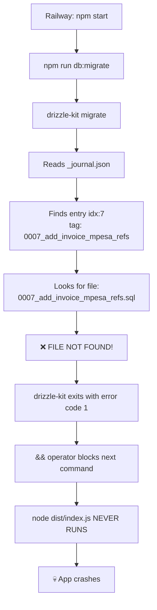

# 🚨 Backend Crash Audit Report

> **Date:** June 14, 2026
> **Status:** Railway deploy CRASHED — app never starts
> **Root Cause:** Missing migration file `0007_add_invoice_mpesa_refs.sql`

---

## 🔴 Root Cause — Why It's Crashing

### The Crash Chain



### What Happened

The start script in [package.json:9](file:///home/moha/Projects/POS/backend/package.json#L9) is:
```json
"start": "npm run db:migrate && node dist/index.js"
```

The migration journal [_journal.json:54-59](file:///home/moha/Projects/POS/backend/src/db/migrations/meta/_journal.json#L54-L59) references:
```json
{
  "idx": 7,
  "tag": "0007_add_invoice_mpesa_refs",
  "breakpoints": true
}
```

But the SQL file `0007_add_invoice_mpesa_refs.sql` **does not exist on disk**. It was deleted when the commit "Add invoiceRef and mpesaRef fields" was REMOVED from Railway — but the journal entry and snapshot file were left behind.

**Migration files that exist:**
```
0000_lean_piledriver.sql       ✅
0001_safe_omega_red.sql        ✅
0002_typical_luminals.sql      ✅
0003_swift_emma_frost.sql      ✅
0004_classy_whirlwind.sql      ✅
0005_dry_golden_guardian.sql   ✅
0006_easy_sunspot.sql          ✅
0007_add_invoice_mpesa_refs.sql  ❌ MISSING!
0008_add_refs.sql              ✅
0009_drop_notes.sql            ✅
```

**Orphaned metadata (in `meta/` dir):**
- `0007_snapshot.json` — exists (48KB) but has no corresponding SQL file

---

## ✅ The Most Efficient Fix

### Fix 1: Create the Missing Migration File (5 seconds — stops the crash)

Create the file with an empty/no-op SQL statement. Migration `0008_add_refs.sql` already does the actual schema changes (adds `invoice_ref` and `mpesa_ref` columns), so `0007` can be a no-op:

> **Create file:** `src/db/migrations/0007_add_invoice_mpesa_refs.sql`
> ```sql
> -- intentionally empty, superseded by 0008_add_refs.sql
> SELECT 1;
> ```

This is the **fastest fix** — the app will start immediately after redeploying.

### Fix 2: Switch to Programmatic Migrations (Recommended long-term — 15 min)

The current approach runs `drizzle-kit` (a CLI dev tool) at startup. This is fragile because:
- `drizzle-kit` is a heavy ~30MB dev tool that shouldn't be in production
- It needs to parse a TypeScript config file at runtime
- Any migration file issue crashes the entire app

**Better approach:** Use Drizzle ORM's built-in `migrate()` function:

```typescript
// src/db/migrate.ts (new file)
import { migrate } from 'drizzle-orm/node-postgres/migrator';
import { db } from './index';

async function runMigrations() {
  console.log('Running migrations...');
  await migrate(db, { migrationsFolder: './src/db/migrations' });
  console.log('Migrations complete.');
}

runMigrations()
  .then(() => process.exit(0))
  .catch((err) => {
    console.error('Migration failed:', err);
    process.exit(1);
  });
```

Then update [package.json](file:///home/moha/Projects/POS/backend/package.json):
```diff
- "start": "npm run db:migrate && node dist/index.js",
- "db:migrate": "drizzle-kit migrate",
+ "start": "node dist/db/migrate.js && node dist/index.js",
+ "db:migrate": "drizzle-kit migrate",
```

And move `drizzle-kit` to `devDependencies`:
```diff
  "dependencies": {
-   "drizzle-kit": "^0.31.10"
  },
  "devDependencies": {
+   "drizzle-kit": "^0.31.10",
  }
```

This eliminates the runtime dependency on `drizzle-kit` entirely.

---

## 🟠 Other Issues Found

### Issue 2: `drizzle-kit` in Production Dependencies

**File:** [package.json:30](file:///home/moha/Projects/POS/backend/package.json#L30)

`drizzle-kit` is in `dependencies` (not `devDependencies`). It's a heavy CLI tool (~30MB) that bloats the production image. It's only here because the start script calls `drizzle-kit migrate`.

**Fix:** Apply Fix 2 above to remove this runtime dependency.

---

### Issue 3: Railway May Not Install `typescript` for Build

**File:** [package.json:43](file:///home/moha/Projects/POS/backend/package.json#L43) — `typescript` is in `devDependencies`

Railway's Nixpacks builder sets `NODE_ENV=production` during install by default. In production mode, `npm install` skips `devDependencies`, which means `tsc` won't be available for the build step.

**Why it works now:** Nixpacks is smart enough to install dev deps when a build command is detected, but this is fragile.

**Fix:** Ensure Railway runs `npm install --include=dev` before build. You can either:
1. Set the Railway env var: `NIXPACKS_NODE_INSTALL_CMD=npm ci --include=dev`
2. Or move `typescript` to `dependencies` (not ideal but reliable)

---

### Issue 4: Email Env Var Mismatch (Non-crashing)

**File:** [.env:5](file:///home/moha/Projects/POS/backend/.env#L5) → `RESEND_API_KEY=re_c5aXgo1V_...`
**File:** [email.service.ts:7](file:///home/moha/Projects/POS/backend/src/core/services/email.service.ts#L7) → checks `BREVO_API_KEY`

The `.env` has `RESEND_API_KEY` but the code reads `BREVO_API_KEY`. Emails will always fall back to mock mode (console.log). Ensure Railway has `BREVO_API_KEY` set.

---

### Issue 5: Migration `0008` and `0009` Have Competing Logic

**File:** [0008_add_refs.sql](file:///home/moha/Projects/POS/backend/src/db/migrations/0008_add_refs.sql) — **DROPS** `categories_name_business_unique` and `product_units_name_product_unique` constraints
**File:** [0009_drop_notes.sql](file:///home/moha/Projects/POS/backend/src/db/migrations/0009_drop_notes.sql) — **RE-ADDS** the same constraints

This works in sequence, but it means migration 0008 temporarily removes important uniqueness constraints. If migration 0009 fails for any reason, the database will be left without these constraints — allowing duplicate category names per business and duplicate unit names per product.

---

## ✅ What's Working Correctly

| Area | Status |
|------|--------|
| TypeScript compilation (`tsc`) | ✅ No errors |
| All import paths resolve correctly | ✅ Verified every file |
| No circular dependencies | ✅ Clean dependency graph |
| All 6 modules registered in index.ts | ✅ auth, catalog, users, suppliers, inventory, purchasing |
| dist/ matches src/ structure | ✅ All files compiled |
| Database connection config | ✅ Pool with error handling |
| Environment validation (Zod) | ✅ At startup |
| `node dist/index.js` runs locally | ✅ Server starts on port 5000 |
| Core middleware (auth, errorHandler) | ✅ Files exist and compile |
| AppError utility | ✅ Properly imported |

---

## 🎯 Action Plan — In Priority Order

| # | Fix | Effort | Impact |
|---|-----|--------|--------|
| **1** | Create empty `0007_add_invoice_mpesa_refs.sql` | 5 sec | 🔴 **Stops the crash** |
| **2** | Switch to programmatic migrations (`drizzle-orm/node-postgres/migrator`) | 15 min | Prevents future migration crashes |
| **3** | Move `drizzle-kit` to `devDependencies` | 1 min | Reduces production image size |
| **4** | Verify Railway env vars (`DATABASE_URL`, `JWT_SECRET`, `BREVO_API_KEY`) | 2 min | Ensures runtime config |
| **5** | Ensure Railway installs dev deps for build | 2 min | Prevents future build failures |

> [!IMPORTANT]
> **Fix #1 alone will stop the crash.** Create the empty migration file, commit, push, and redeploy. The app will start.

---

## Quick Fix Commands

```bash
# Fix 1: Create the missing migration file
echo '-- intentionally empty, superseded by 0008_add_refs.sql\nSELECT 1;' > src/db/migrations/0007_add_invoice_mpesa_refs.sql

# Verify it works
npm run db:migrate && node dist/index.js

# Commit and deploy
git add src/db/migrations/0007_add_invoice_mpesa_refs.sql
git commit -m "fix: add missing migration 0007 to fix Railway crash"
git push
```
