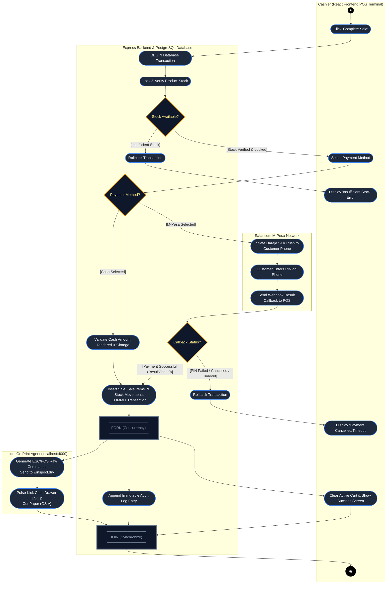

# Smart Store POS — UML Activity Diagram

This document models the dynamic, procedural workflow of the **Smart Store POS** system using the **UML Activity Diagram** standard.

---

## 1. Quick Concept Refresher

An **Activity Diagram** describes the **step-by-step flow of control and data** across business logic, systems, or human users. While a Use Case diagram shows *what* happens at a high level, an Activity diagram shows *how* a process unfolds over time.

| Element | UML Standard Notation | Meaning & Purpose |
|---|---|---|
| **Initial Node** | Solid filled circle `(●)` | The starting point of the activity. An activity has exactly one initial node (or one per trigger). |
| **Action State** | Rounded rectangle `([Action Name])` | A single step or task that cannot be decomposed further at this level (e.g., *Hash Password*, *Deduct Stock*). |
| **Control Flow** | Directed solid arrow `-->` | Directs execution from one action state to the next. |
| **Decision Node** | Diamond `◇` with 1 input and 2+ outputs | A conditional branch point. Every outgoing arrow **must** have a **Guard Condition** in brackets, e.g., `[Stock Available]`. |
| **Merge Node** | Diamond `◇` with 2+ inputs and 1 output | Brings alternative branches back together into a single path. No conditions are evaluated here. |
| **Fork Bar** | Thick horizontal/vertical solid bar `═══` | Splits a single incoming path into **two or more concurrent / parallel** paths. |
| **Join Bar** | Thick horizontal/vertical solid bar `═══` | Synchronizes parallel paths. Execution pauses until **all** incoming parallel branches complete. |
| **Swimlanes (Partitions)** | Parallel columns / containers | Group actions by organizational role, system component, or execution environment (e.g., *Frontend*, *Backend*, *Payment Gateway*). |
| **Activity Final Node** | Bullseye circle `(◉)` | Terminates the entire activity and all active flows within it. |
| **Flow Final Node** | Circle with an "X" `(⊗)` | Terminates only the current path/branch without stopping other concurrent branches. |

---

## 2. Chosen Comprehensive Workflow: POS Checkout & Payment Processing

We picked the **POS Checkout & Multi-Payment Processing** flow because it exercises **every major feature** of a UML Activity diagram:
1. **Partitions / Swimlanes:** Traverses four boundaries (Cashier UI $\rightarrow$ Express Backend & Database $\rightarrow$ Safaricom M-Pesa Gateway $\rightarrow$ Local Thermal Print Agent).
2. **Decisions & Guard Conditions:** Stock validation, Cash vs. M-Pesa branch, Payment success vs. timeout/failure.
3. **Rollback & Alternate Paths:** Transaction abortion if stock is depleted or M-Pesa request times out.
4. **Fork & Join Concurrency:** Once the database transaction commits, the system simultaneously dispatches silent receipt printing to the local hardware daemon, writes to the immutable audit log, and updates client-side cart cache.

---

## 3. The Activity Diagram

---

## 4. Why Each UML Feature Was Chosen (And Why Others Were Avoided)

### 1. Why Swimlanes (Partitions) are Essential Here
* **Why used:** In this POS system, a sale is not a single monolith. Different steps happen on the **browser**, in **Postgres transactions**, over the **cellular network (Safaricom)**, and on **desktop hardware (`winspool.drv`)**. 
* **Key Learning:** Without swimlanes, you know *what* happens, but you have no idea *who owns the responsibility*. Swimlanes clearly document system boundaries and network crossings.

---

### 2. Decision Node vs. Merge Node (The Two Faces of the Diamond `◇`)
* **Decision Node (Branching):** Has **one incoming arrow** and **two or more outgoing arrows**, each labeled with a mutually exclusive **Guard Condition** enclosed in square brackets `[ ... ]`.
  * *Example:* `Dec_Stock` checks `[Stock Verified]` vs. `[Insufficient Stock]`.
* **Merge Node (Converging):** Has **multiple incoming arrows** and **one outgoing arrow**. It merges alternative paths back into one flow.
  * *Notice:* A merge diamond does **NOT** wait for all paths to arrive. Whichever single path was taken passes straight through.

---

### 3. Fork vs. Join Bars (Concurrency and Synchronization)
* **Fork Bar (Splitting into Parallel Work):**
  * Once the database transaction commits, three independent operations do **not** need to wait for each other in series:
    1. The Go Print Agent can begin sending byte streams to the USB thermal printer.
    2. The Backend can append the audit log entry to disk/database.
    3. The Frontend can transition the cashier's UI to the success screen and reset the cart state.
  * We use a **Fork Bar** to show that these three tasks execute concurrently.
* **Join Bar (Synchronization):**
  * The activity cannot be marked fully completed until **all three concurrent paths finish**.
  * A **Join Bar** pauses execution until all incoming parallel branches have arrived, after which it emits a single flow to the **Activity Final Node `(◉)`**.

---

### 4. Why We Showed Transaction Rollbacks
* **Why used:** Software architecture diagrams often show only the "happy path." A robust UML Activity Diagram models **business exceptions**. 
* If a customer enters the wrong M-Pesa PIN, or if stock was sold out between cart addition and checkout submission, the flow branches to a rollback action state and routes an error back to the Cashier partition, avoiding data corruption.

---

### 5. Why an Activity Diagram (and not a Sequence Diagram) for this Phase?
* A **Sequence Diagram** focuses on the chronological order of method calls and HTTP messages exchanged between specific objects (`Cashier -> POST /api/sales -> salesService.createSale()`).
* An **Activity Diagram** focuses on the **high-level operational workflow, decision logic, and concurrency**, making it much better for understanding business processes and state flow before diving into low-level code mechanics.
