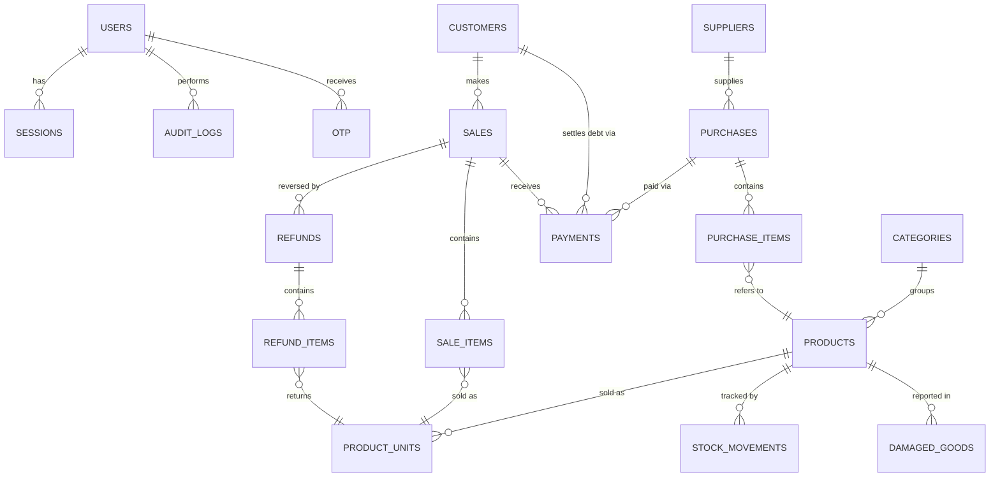

# Entity Relationship Diagram

## Diagram

---

## Table Relationships Explained

### Why `SALE_ITEMS` references `PRODUCT_UNITS` (not `PRODUCTS`)

A sale must record exactly which unit was sold (a Bag vs a Roll vs a Kg). The unit determines the price at time of sale. If product unit prices change later, the historical sale price is still correct because we snapshot the `unit_price` on the sale item at the time of the transaction.

### Why `PAYMENTS` is polymorphic

Payments can be made against four different contexts:
- A sale (customer paying for goods)
- A purchase (store paying a supplier)
- A customer debt (customer settling an outstanding balance)
- A supplier debt (store settling an outstanding supplier balance)

Rather than creating four separate payment tables with duplicated columns, a single `payments` table uses `reference_type` + `reference_id` to point to any of these. This keeps payment processing logic centralized.

### Why `STOCK_MOVEMENTS` never deletes

The `stock_movements` table is a ledger. Rows are only ever inserted, never updated or deleted. This makes the stock history fully auditable and allows recalculating stock at any point in time.

### Why `REFUNDS` don't modify `SALES`

Financial records must remain historically accurate. If a sale for KES 5,000 is partially refunded, the sale still shows KES 5,000 (what was charged). The refund record shows what was returned. Reporting can combine both to show net revenue. Modifying the original sale would corrupt financial history.

---

## Cardinality Notes

| Relationship | Type | Notes |
|---|---|---|
| Category → Products | 1:Many | A product belongs to one category |
| Product → Product Units | 1:Many | At least one unit required; one marked default |
| Product → Stock Movements | 1:Many | Append-only; no upper limit |
| Supplier → Purchases | 1:Many | A purchase has exactly one supplier |
| Purchase → Purchase Items | 1:Many | At least one item per purchase |
| Customer → Sales | 0:Many | Customer is optional on a sale (walk-ins) |
| Sale → Sale Items | 1:Many | At least one item per sale |
| Sale → Payments | 1:Many | A sale may have multiple payment records (split payment) |
| Sale → Refunds | 0:Many | Most sales will have no refunds |
| Refund → Refund Items | 1:Many | At least one item per refund |
| User → Audit Logs | 1:Many | Every action is attributed to the user |
