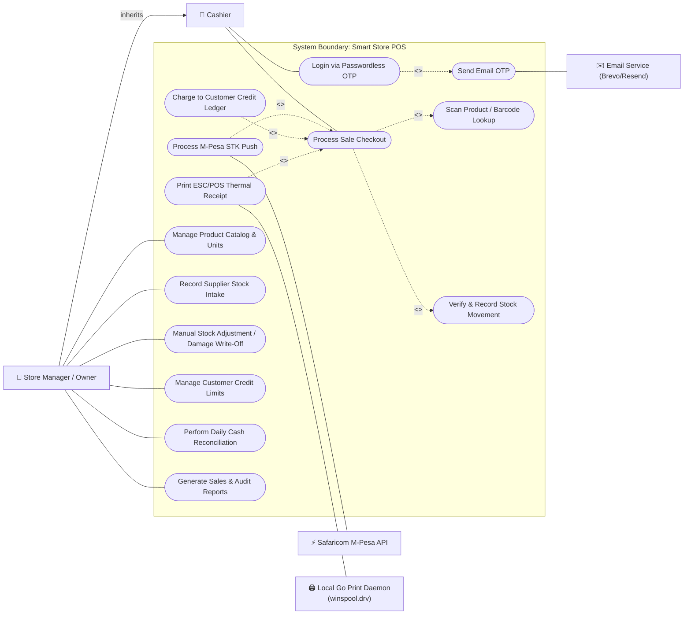

# Smart Store POS — UML Use Case Analysis & Diagram

This document models the functional requirements and user interactions of the **Smart Store POS** system using the **Unified Modeling Language (UML) Use Case** standard.

---

## 1. Quick Concept Refresher

| Concept | Visual Notation | Definition & Purpose |
|---|---|---|
| **System Boundary** | Rectangle surrounding use cases | Defines the perimeter of your software. Everything inside is built by you; everything outside is an external entity. |
| **Actor** | Stick figure / labeled entity | An external entity (person, organization, or external system) that interacts with the system to achieve a specific goal. |
| **Use Case** | Oval `([Verb + Noun])` | A complete, discrete unit of observable business value that the system delivers to an actor. |
| **Association** | Solid line `───` | Indicates that an actor communicates with or triggers a use case. |
| **`<<include>>`** | Dashed arrow pointing from Base to Included `Base ..> Included` | **Mandatory dependency**: The base use case *cannot* complete without executing the included use case. Used to factor out shared, non-optional steps. |
| **`<<extend>>`** | Dashed arrow pointing from Extension to Base `Extension ..> Base` | **Optional / Conditional hook**: The extension use case only runs under specific trigger conditions or optional paths at a defined extension point. |
| **Generalization** | Solid line with hollow triangle arrow `──▷` | **Inheritance**: Can be applied to **Actors** (a specialized actor inherits all use cases of the generalized actor) or **Use Cases** (specialized variations of a general process). |

---

## 2. Smart Store POS — Use Case Diagram

---

## 3. Detailed Component & Relationship Walkthrough

### A. Actors
1. **Primary Actors (Humans):**
   * **Cashier:** Front-line staff who operates the terminal at the checkout counter. Needs high-velocity sales workflows, product scanning, and payment processing.
   * **Store Manager / Owner:** Administrative staff who configures prices, stocks inventory, manages customer credit agreements, and reconciles cash.
   * *Notice who is NOT here:* The **Customer** is not a primary actor in this diagram. In a brick-and-mortar store POS, the customer does not log in or touch the terminal screen; the cashier acts as the proxy operating the system on their behalf.
2. **Secondary / System Actors (Services):**
   * **Safaricom M-Pesa API:** External payment gateway that receives STK pushes and delivers asynchronous payment callbacks.
   * **Local Print Daemon (`winspool.drv`):** External desktop hardware bridge running on `localhost:4000` that converts raw ESC/POS commands to physical paper cuts and cash drawer pulses.
   * **Email Service (Resend/Brevo):** Delivers passwordless 6-digit OTP codes to user inboxes.

---

### B. Why Certain Relationships Were Chosen

#### 1. Actor Inheritance (`Manager --|> Cashier`)
* **Why:** In retail operations, a store manager can step up to any counter and run a sale, look up a barcode, or process a payment. Rather than drawing 6 identical messy lines connecting `Manager` to all cashier use cases, UML allows **Actor Generalization**. `Manager` automatically inherits all capabilities of `Cashier`, while having exclusive access to administrative use cases (stock adjustments, credit limits, reports).

#### 2. `<<include>>` on `UC_DeductStock` and `UC_Scan`
* **Why `<<include>>` instead of `<<extend>>`?**
  * When a sale is completed, deducting stock is **mandatory and unconditional**. A sale cannot succeed without an atomic inventory deduction (guaranteed by ACID transactions).
  * Similarly, every checkout unconditionally requires identifying items via barcode lookup or search.
  * In UML, whenever step B is an indispensable sub-part of step A, you use `<<include>>` (Arrow points from `Base -> Included`).

#### 3. `<<extend>>` on `UC_MpesaPayment`, `UC_CreditPayment`, and `UC_PrintReceipt`
* **Why `<<extend>>` instead of `<<include>>`?**
  * **Conditionality:** Not every customer pays via M-Pesa (some pay cash). Not every customer has store credit. Not every transaction requests a printed receipt (or the printer might be switched off / digital fallback used).
  * **UML Standard Direction:** In UML, an extend arrow points **from the extension use case back to the base use case** (`Extension ..> Base`). It indicates: *"The extension use case conditionally injects its behavior into the base use case at a specific extension point."*

#### 4. Why Use Case Generalization was NOT used for payments here
* **Design Decision:** You might wonder: *“Why didn't we make a parent use case `Pay Bill` and make `Pay Cash`, `Pay M-Pesa`, `Pay Credit` children via generalization?”*
* **Reason:** In modern POS systems, transactions frequently feature **Split Payments** (e.g., paying 500 KES in cash and 1,200 KES via M-Pesa on the same cart). Treating payment options as conditional extension modules (`<<extend>>`) reflects real-world checkout workflows much more naturally than a rigid single-inheritance hierarchy.

---

## 4. Key Use Case Specification Example

### Use Case: `Process Sale Checkout`
* **Primary Actor:** Cashier (and by inheritance, Store Manager)
* **Preconditions:** Cashier is authenticated with a valid JWT session; register session is active.
* **Trigger:** Cashier initiates checkout from the active cart.
* **Main Success Scenario:**
  1. Cashier scans product barcodes or selects catalog items (`<<include>>` Scan Product).
  2. System calculates subtotal, applied taxes, and discounts in real time.
  3. Cashier selects payment method (Default: Cash).
  4. System verifies stock levels and registers immutable stock decrement ledger entries (`<<include>>` Deduct Stock).
  5. System records the sale atomically within a database transaction.
  6. System triggers hardware agent to cut paper receipt and pop open cash drawer (`<<extend>>` Print ESC/POS Receipt).
* **Extensions (Alternative Paths):**
  * **3a. M-Pesa Payment Selected:**
    * System initiates STK Push to customer's mobile phone via Safaricom API (`<<extend>>` M-Pesa STK Push).
    * System waits for webhook/callback confirming funds before committing transaction.
  * **3b. Customer Credit Selected:**
    * System validates customer's remaining credit ceiling (`<<extend>>` Customer Credit Ledger).
    * If within limit, transaction commits and appends debit to customer's ledger balance.

---

## 5. Architectural Rule: Can You Nest Use Case Diagrams?

> [!IMPORTANT]
> **No. In strict UML 2.x standard, there is no such concept as "nesting" use case diagrams or boundaries.**
> 
> A Use Case Diagram has:
> 1. **Exactly one System Boundary** (the Subject/System).
> 2. Inside the boundary, **only Use Case ovals** `([Verb + Noun])` and relationships (`<<include>>`, `<<extend>>`, generalization) exist.
> 3. Actors strictly sit **outside** the boundary.
>
> If a system is large and has dozens of use cases, UML does not nest boxes inside the boundary. Instead, you handle scale via:
> - **UML Packages (`<<package>>`):** Grouping use cases into logical packages represented by folder tabs.
> - **Diagram Decomposition:** Splitting the system into separate, focused Use Case diagrams (e.g., *Sales & Checkout Diagram*, *Inventory Management Diagram*).

