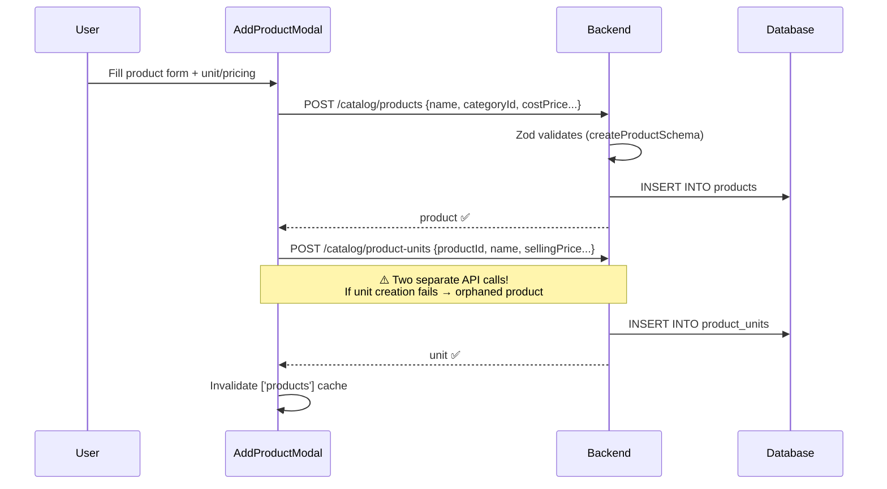
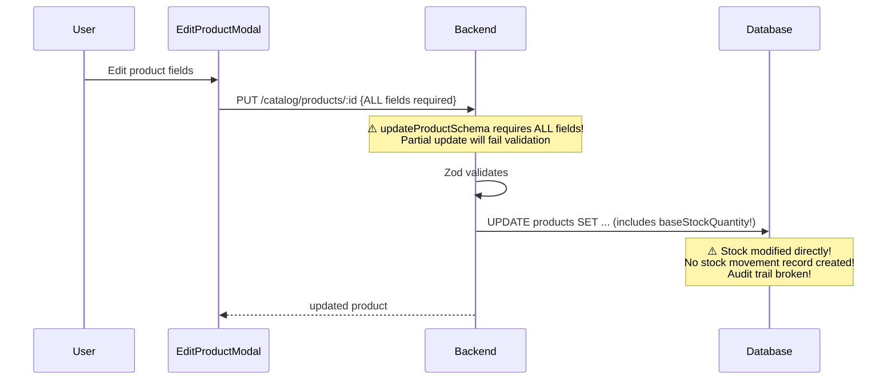
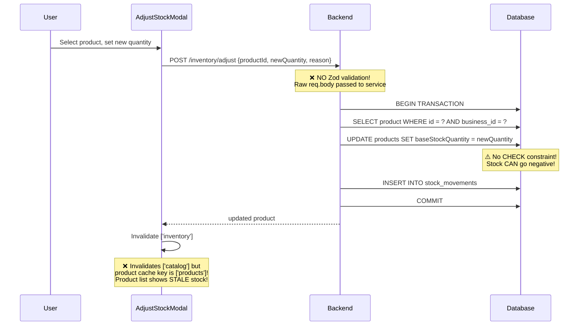
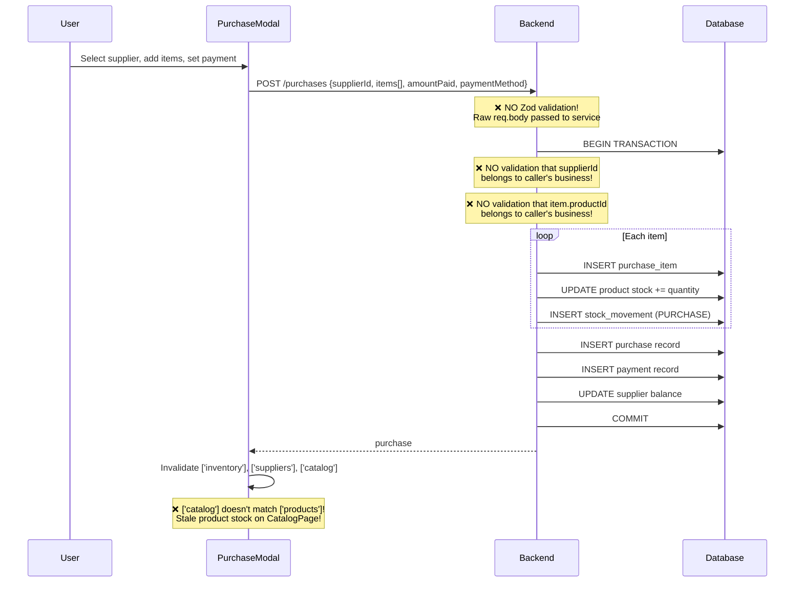
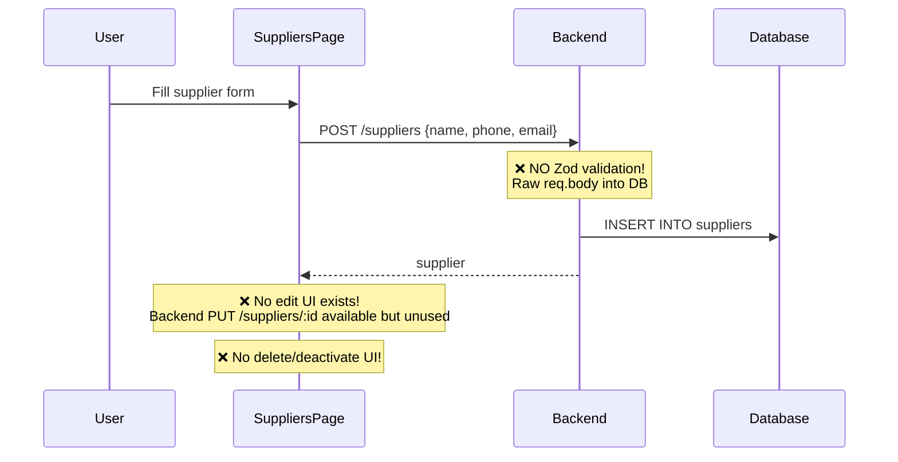

# 🔍 POS Phase 3 & 4 — Comprehensive Audit Report

> **Scan Date:** June 12, 2026
> **Scope:** Catalog (Phase 3), Inventory, Purchasing & Suppliers (Phase 4) — Backend + Frontend
> **Total Issues Found:** 72 across all layers

---

## Table of Contents

1. [Executive Summary](#1-executive-summary)
2. [Data Flow Analysis](#2-data-flow-analysis)
3. [Critical Bugs (Fix Immediately)](#3-critical-bugs--fix-immediately)
4. [Database & Schema Issues](#4-database--schema-issues)
5. [Backend Issues by Module](#5-backend-issues-by-module)
6. [Frontend Issues by Feature](#6-frontend-issues-by-feature)
7. [Cross-Cutting Concerns](#7-cross-cutting-concerns)
8. [Missing Features Summary](#8-missing-features-summary)
9. [Prioritized Action Plan](#9-prioritized-action-plan)

---

## 1. Executive Summary

Phase 3 (Catalog) is **functionally stable** but has validation gaps and missing CRUD operations. Phase 4 (Inventory, Purchasing, Suppliers) has **critical security and data integrity issues** — three entire modules have **zero Zod input validation**, no role-based authorization, and cross-tenant data manipulation vulnerabilities.

### Severity Breakdown

| Severity | Count | Description |
|----------|-------|-------------|
| 🔴 **CRITICAL** | 9 | Security vulnerabilities, data corruption, broken data flows |
| 🟠 **HIGH** | 11 | Authorization gaps, broken updates, data integrity risks |
| 🟡 **MEDIUM** | 25 | Performance issues, missing error handling, UX problems |
| 🟢 **LOW** | 27 | Dead code, missing features, minor UX, accessibility |

> [!CAUTION]
> **The Inventory, Purchasing, and Suppliers modules have ZERO input validation.** Raw `req.body` is passed directly to database operations. An attacker can inject arbitrary fields, set negative quantities, manipulate supplier balances, and reference data from other businesses.

---

## 2. Data Flow Analysis

### 2a. 📦 Product Creation Flow (Phase 3)



#### Issues in this flow:

| # | Issue | Severity | File |
|---|-------|----------|------|
| 1 | Two-step creation can orphan products (product created, unit fails) | 🟠 | [AddProductModal.tsx:55-68](file:///home/moha/Projects/POS/frontend/src/features/catalog/components/AddProductModal.tsx#L55-L68) |
| 2 | `useCreateProductUnit` has no cache invalidation on success | 🟡 | [catalog.api.ts:88-95](file:///home/moha/Projects/POS/frontend/src/features/catalog/api/catalog.api.ts#L88-L95) |
| 3 | Multiple default units allowed — no mutual exclusion logic | 🟠 | [catalog.service.ts:121-134](file:///home/moha/Projects/POS/backend/src/modules/catalog/catalog.service.ts#L121-L134) |

---

### 2b. ✏️ Product Update Flow (Phase 3)



#### Issues in this flow:

| # | Issue | Severity | File |
|---|-------|----------|------|
| 1 | `updateProductSchema` requires ALL fields — partial updates fail | 🟠 | [catalog.schema.ts:25-33](file:///home/moha/Projects/POS/backend/src/modules/catalog/catalog.schema.ts#L25-L33) |
| 2 | `baseStockQuantity` editable via product form — bypasses inventory ledger | 🟠 | [EditProductModal.tsx:141-155](file:///home/moha/Projects/POS/frontend/src/features/catalog/components/EditProductModal.tsx#L141-L155) |
| 3 | `updateProduct` service uses `data: any` type | 🟡 | [catalog.service.ts:88](file:///home/moha/Projects/POS/backend/src/modules/catalog/catalog.service.ts#L88) |
| 4 | Double-writes numeric fields (spread then conditional override) | 🟡 | [catalog.service.ts:94-100](file:///home/moha/Projects/POS/backend/src/modules/catalog/catalog.service.ts#L94-L100) |

---

### 2c. 📊 Stock Adjustment Flow (Phase 4)



#### Issues in this flow:

| # | Issue | Severity | File |
|---|-------|----------|------|
| 1 | **ZERO input validation** — no Zod schema | 🔴 | [inventory.controller.ts:18-34](file:///home/moha/Projects/POS/backend/src/modules/inventory/inventory.controller.ts#L18-L34) |
| 2 | **Stock can go negative** — no DB check or app-level guard | 🔴 | [inventory.service.ts:36-42](file:///home/moha/Projects/POS/backend/src/modules/inventory/inventory.service.ts#L36-L42) |
| 3 | Cache invalidation uses `['catalog']` instead of `['products']` — stale UI | 🔴 | [AdjustStockModal.tsx:23-24](file:///home/moha/Projects/POS/frontend/src/features/inventory/components/AdjustStockModal.tsx#L23-L24) |
| 4 | No `onError` handler — silent failure on API error | 🟠 | [AdjustStockModal.tsx:20-36](file:///home/moha/Projects/POS/frontend/src/features/inventory/components/AdjustStockModal.tsx#L20-L36) |
| 5 | Any authenticated user can adjust stock (no role check) | 🟠 | [inventory.routes.ts:9-11](file:///home/moha/Projects/POS/backend/src/modules/inventory/inventory.routes.ts#L9-L11) |

---

### 2d. 🛒 Purchase Recording Flow (Phase 4)



#### Issues in this flow:

| # | Issue | Severity | File |
|---|-------|----------|------|
| 1 | **ZERO input validation** — no Zod schema | 🔴 | [purchasing.controller.ts:7](file:///home/moha/Projects/POS/backend/src/modules/purchasing/purchasing.controller.ts#L7) |
| 2 | **No cross-tenant validation** — supplier/product from any business | 🔴 | [purchasing.service.ts:19-84](file:///home/moha/Projects/POS/backend/src/modules/purchasing/purchasing.service.ts#L19-L84) |
| 3 | **Floating-point arithmetic** for financial calculations | 🟡 | [purchasing.service.ts:22-24](file:///home/moha/Projects/POS/backend/src/modules/purchasing/purchasing.service.ts#L22-L24) |
| 4 | `amountPaid` can exceed `totalAmount` — negative supplier balance | 🟡 | [purchasing.service.ts:26](file:///home/moha/Projects/POS/backend/src/modules/purchasing/purchasing.service.ts#L26) |
| 5 | Cache invalidation uses `['catalog']` instead of `['products']` | 🔴 | [PurchaseModal.tsx:32-34](file:///home/moha/Projects/POS/frontend/src/features/inventory/components/PurchaseModal.tsx#L32-L34) |
| 6 | No `onError` handler — silent failure | 🟠 | [PurchaseModal.tsx:29-37](file:///home/moha/Projects/POS/frontend/src/features/inventory/components/PurchaseModal.tsx#L29-L37) |
| 7 | Uses `alert()` for validation instead of inline error | 🟡 | [PurchaseModal.tsx:44](file:///home/moha/Projects/POS/frontend/src/features/inventory/components/PurchaseModal.tsx#L44) |

---

### 2e. 🏭 Supplier Management Flow (Phase 4)



#### Issues in this flow:

| # | Issue | Severity | File |
|---|-------|----------|------|
| 1 | **ZERO input validation** on create and update | 🔴 | [suppliers.controller.ts:31,40](file:///home/moha/Projects/POS/backend/src/modules/suppliers/suppliers.controller.ts#L31) |
| 2 | **Raw `req.body` spread into DB update** — can override any column | 🔴 | [suppliers.service.ts:46](file:///home/moha/Projects/POS/backend/src/modules/suppliers/suppliers.service.ts#L46) |
| 3 | In-memory search filtering instead of DB `ilike` | 🟡 | [suppliers.service.ts:7-17](file:///home/moha/Projects/POS/backend/src/modules/suppliers/suppliers.service.ts#L7-L17) |
| 4 | No search debounce — every keystroke fires API call | 🟡 | [SuppliersPage.tsx:12-15](file:///home/moha/Projects/POS/frontend/src/pages/SuppliersPage.tsx#L12-L15) |
| 5 | No `onError` handler on mutation | 🟡 | [SuppliersPage.tsx:19-26](file:///home/moha/Projects/POS/frontend/src/pages/SuppliersPage.tsx#L19-L26) |
| 6 | Form doesn't reset when modal closed without submit | 🟡 | [SuppliersPage.tsx:120](file:///home/moha/Projects/POS/frontend/src/pages/SuppliersPage.tsx#L120) |

---

## 3. Critical Bugs — Fix Immediately

> [!CAUTION]
> These 9 issues can cause security breaches, data corruption, or broken user experiences.

### 🔴 CRIT-1: Zero Input Validation on Inventory Module

**File:** [inventory.controller.ts:18-34](file:///home/moha/Projects/POS/backend/src/modules/inventory/inventory.controller.ts#L18-L34)

No Zod schema file exists in the inventory module. `req.body` is passed raw to services. An attacker can:
- Send `quantity: -100` to `recordDamage` → `-(-100) = +100` stock INCREASE via the damage endpoint
- Send `newQuantity: "abc"` → NaN propagation
- Send arbitrary extra fields into DB inserts

**Fix:** Create `inventory.schema.ts` with Zod schemas:
```typescript
export const adjustStockSchema = z.object({
  productId: z.string().uuid(),
  newQuantity: z.number().int().min(0),
  reason: z.string().min(1).max(500),
});

export const recordDamageSchema = z.object({
  productId: z.string().uuid(),
  quantity: z.number().int().positive(),
  description: z.string().min(1).max(500),
});
```

---

### 🔴 CRIT-2: Zero Input Validation on Purchasing Module

**File:** [purchasing.controller.ts:7](file:///home/moha/Projects/POS/backend/src/modules/purchasing/purchasing.controller.ts#L7)

No validation on `createPurchase`. Attacker can send `items: []`, negative amounts, non-UUID product IDs, or invalid payment methods.

**Fix:** Create `purchasing.schema.ts`:
```typescript
export const createPurchaseSchema = z.object({
  supplierId: z.string().uuid(),
  items: z.array(z.object({
    productId: z.string().uuid(),
    quantity: z.number().int().positive(),
    costPrice: z.number().positive(),
  })).min(1, 'At least one item required'),
  amountPaid: z.number().min(0),
  paymentMethod: z.enum(['CASH', 'MPESA', 'BANK_TRANSFER']),
});
```

---

### 🔴 CRIT-3: Zero Input Validation on Suppliers Module

**Files:** [suppliers.controller.ts:31,40](file:///home/moha/Projects/POS/backend/src/modules/suppliers/suppliers.controller.ts#L31)

Raw `req.body` spread directly into DB operations. On update, attacker can send `{ "balance": 0, "businessId": "other-id" }` to zero out supplier debt or attempt tenant manipulation.

**Fix:** Create `suppliers.schema.ts`:
```typescript
export const createSupplierSchema = z.object({
  name: z.string().min(2).max(255),
  phone: z.string().min(1).max(50).optional(),
  email: z.string().email().optional(),
});
export const updateSupplierSchema = createSupplierSchema.partial();
```

---

### 🔴 CRIT-4: Cross-Tenant Data Manipulation in Purchases

**File:** [purchasing.service.ts:19-84](file:///home/moha/Projects/POS/backend/src/modules/purchasing/purchasing.service.ts#L19-L84)

`createPurchase` never validates that `supplierId` or item `productId` values belong to the caller's `businessId`. Business A can:
- Reference Business B's supplier → manipulate their balance
- Reference Business B's products → add stock to wrong tenant

**Fix:** Add validation queries inside the transaction:
```typescript
const [supplier] = await tx.select().from(suppliers)
  .where(and(eq(suppliers.id, data.supplierId), eq(suppliers.businessId, businessId)));
if (!supplier) throw new AppError('Supplier not found', 404);

// For each item:
const [product] = await tx.select().from(products)
  .where(and(eq(products.id, item.productId), eq(products.businessId, businessId)));
if (!product) throw new AppError(`Product ${item.productId} not found`, 404);
```

---

### 🔴 CRIT-5: Stock Can Go Negative

**File:** [inventory.service.ts:36-42](file:///home/moha/Projects/POS/backend/src/modules/inventory/inventory.service.ts#L36-L42)

`recordMovement` adds `quantityChange` to `baseStockQuantity` without checking result. If stock is 5 and damage of 10 is recorded, stock becomes -5. No DB `CHECK` constraint exists.

**Fix:**
1. Add DB check: `CHECK (base_stock_quantity >= 0)` in schema
2. Add app-level guard before update:
```typescript
if (type === 'DAMAGE' || type === 'SALE') {
  const [product] = await tx.select().from(products).where(...);
  if (Number(product.baseStockQuantity) + quantityChange < 0) {
    throw new AppError('Insufficient stock', 400);
  }
}
```

---

### 🔴 CRIT-6: Negative Damage Quantity Inverts Logic

**File:** [inventory.service.ts:94-113](file:///home/moha/Projects/POS/backend/src/modules/inventory/inventory.service.ts#L94-L113)

`recordDamage` does `quantityChange: -data.quantity`. Without validation, if `data.quantity` is negative (e.g., `-50`), then `quantityChange` becomes `+50` — the "damage" endpoint actually **increases** stock. The DB has `CHECK (quantity > 0)` on `damaged_goods` which catches this, but the error message is a cryptic Postgres constraint violation.

---

### 🔴 CRIT-7: Raw Body Spread Into DB Update (Suppliers)

**File:** [suppliers.service.ts:46](file:///home/moha/Projects/POS/backend/src/modules/suppliers/suppliers.service.ts#L46)

```typescript
.set({ ...data, updatedAt: new Date() })
```

`data` is raw `req.body`. An attacker can override `balance`, `businessId`, `createdBy`, or any other column.

---

### 🔴 CRIT-8: Stale Cache After Stock Operations

**Files:** [AdjustStockModal.tsx:23-24](file:///home/moha/Projects/POS/frontend/src/features/inventory/components/AdjustStockModal.tsx#L23-L24), [PurchaseModal.tsx:32-34](file:///home/moha/Projects/POS/frontend/src/features/inventory/components/PurchaseModal.tsx#L32-L34)

Both modals invalidate `['catalog']` after stock changes, but the actual query key for products is `['products']` (defined in [catalog.api.ts:35](file:///home/moha/Projects/POS/frontend/src/features/catalog/api/catalog.api.ts#L35)). **The CatalogPage will display stale stock quantities** until the user manually refreshes.

**Fix:** Change `['catalog']` to `['products']` in both files:
```typescript
queryClient.invalidateQueries({ queryKey: ['products'] });
```

---

### 🔴 CRIT-9: Operator Precedence Bug in AdjustStockModal Validation

**File:** [AdjustStockModal.tsx:38-40](file:///home/moha/Projects/POS/frontend/src/features/inventory/components/AdjustStockModal.tsx#L38-L40)

```typescript
if (!productId || quantity <= 0 && mode === 'DAMAGE') return;
```

Due to JS operator precedence, this evaluates as `!productId || (quantity <= 0 && mode === 'DAMAGE')`. In ADJUST mode, `quantity <= 0` is **never checked** — submitting with quantity 0 or negative quantities passes validation.

**Fix:** Add explicit parentheses:
```typescript
if (!productId || (mode === 'DAMAGE' && quantity <= 0) || (mode === 'ADJUST' && newQuantity < 0)) return;
```

---

## 4. Database & Schema Issues

### Schema Anomalies

| # | Issue | Severity | Location |
|---|-------|----------|----------|
| S-1 | Missing `business_id` index on `suppliers` table | 🟡 | [schema.ts:112-123](file:///home/moha/Projects/POS/backend/src/db/schema.ts#L112-L123) |
| S-2 | Missing `business_id` index on `purchases` table | 🟡 | [schema.ts:125-141](file:///home/moha/Projects/POS/backend/src/db/schema.ts#L125-L141) |
| S-3 | Missing `business_id` indexes on `purchase_items`, `payments`, `stock_movements`, `damaged_goods` | 🟡 | [schema.ts:143-205](file:///home/moha/Projects/POS/backend/src/db/schema.ts#L143-L205) |
| S-4 | `products.categoryId` FK has no `onDelete` behavior — defaults to NO ACTION | 🟠 | [schema.ts:72](file:///home/moha/Projects/POS/backend/src/db/schema.ts#L72) |
| S-5 | `purchases.supplierId` FK has no `onDelete` — can orphan purchases | 🟡 | [schema.ts:128](file:///home/moha/Projects/POS/backend/src/db/schema.ts#L128) |
| S-6 | `stockMovements.productId` and `damagedGoods.productId` no `onDelete` | 🟡 | [schema.ts:177,195](file:///home/moha/Projects/POS/backend/src/db/schema.ts#L177) |
| S-7 | `payments.referenceId` is polymorphic — no FK constraint at DB level | 🟢 | [schema.ts:161-162](file:///home/moha/Projects/POS/backend/src/db/schema.ts#L161-L162) |
| S-8 | Migration 0005 missing `business_id` indexes for all new tables | 🟡 | Migration 0005 lines 101-112 |

### Recommended Schema Additions

```sql
-- Add missing indexes (generate new migration)
CREATE INDEX suppliers_business_idx ON suppliers(business_id);
CREATE INDEX purchases_business_idx ON purchases(business_id);
CREATE INDEX purchase_items_business_idx ON purchase_items(business_id);
CREATE INDEX payments_business_idx ON payments(business_id);
CREATE INDEX stock_movements_business_idx ON stock_movements(business_id);
CREATE INDEX damaged_goods_business_idx ON damaged_goods(business_id);

-- Add stock non-negative constraint
ALTER TABLE products ADD CONSTRAINT chk_stock_non_negative 
  CHECK (base_stock_quantity >= 0);

-- Add onDelete behaviors
ALTER TABLE products DROP CONSTRAINT products_category_id_fk;
ALTER TABLE products ADD CONSTRAINT products_category_id_fk 
  FOREIGN KEY (category_id) REFERENCES categories(id) ON DELETE RESTRICT;
```

---

## 5. Backend Issues by Module

### 📦 Catalog Module (Phase 3)

| # | Issue | Severity | File | Fix |
|---|-------|----------|------|-----|
| C-1 | `updateProductSchema` requires ALL fields — partial updates fail | 🟠 | [catalog.schema.ts:25-33](file:///home/moha/Projects/POS/backend/src/modules/catalog/catalog.schema.ts#L25-L33) | Use `.partial()` on the schema |
| C-2 | `updateProduct` uses `data: any` — no type safety | 🟡 | [catalog.service.ts:88](file:///home/moha/Projects/POS/backend/src/modules/catalog/catalog.service.ts#L88) | Type as `UpdateProductInput` |
| C-3 | Double-writes numeric fields in update | 🟡 | [catalog.service.ts:94-100](file:///home/moha/Projects/POS/backend/src/modules/catalog/catalog.service.ts#L94-L100) | Only spread validated fields |
| C-4 | No UUID validation on `req.params.id` | 🟢 | [catalog.controller.ts:61,72,84](file:///home/moha/Projects/POS/backend/src/modules/catalog/catalog.controller.ts#L61) | Add Zod param validation |
| C-5 | No role-based authorization on catalog write routes | 🟡 | [catalog.routes.ts:10-19](file:///home/moha/Projects/POS/backend/src/modules/catalog/catalog.routes.ts#L10-L19) | Add `authorize(['OWNER'])` |
| C-6 | `costPrice` Zod requires `>0`, DB allows `>=0` | 🟢 | [catalog.schema.ts:12](file:///home/moha/Projects/POS/backend/src/modules/catalog/catalog.schema.ts#L12) | Align validation |
| C-7 | No pagination metadata (total count, hasMore) | 🟢 | [catalog.controller.ts:18-28](file:///home/moha/Projects/POS/backend/src/modules/catalog/catalog.controller.ts#L18-L28) | Return `{ data, meta }` |
| C-8 | Multiple default units allowed per product | 🟠 | [catalog.service.ts:121-134](file:///home/moha/Projects/POS/backend/src/modules/catalog/catalog.service.ts#L121-L134) | Unset others in transaction |
| C-9 | Missing `GET/PUT/DELETE` for product units | 🟡 | [catalog.routes.ts:19](file:///home/moha/Projects/POS/backend/src/modules/catalog/catalog.routes.ts#L19) | Add CRUD routes |
| C-10 | Missing `PUT/DELETE` for categories | 🟡 | [catalog.routes.ts:10-11](file:///home/moha/Projects/POS/backend/src/modules/catalog/catalog.routes.ts#L10-L11) | Add edit/delete |

---

### 📊 Inventory Module (Phase 4)

| # | Issue | Severity | File | Fix |
|---|-------|----------|------|-----|
| I-1 | **ZERO input validation** | 🔴 | [inventory.controller.ts:18-34](file:///home/moha/Projects/POS/backend/src/modules/inventory/inventory.controller.ts#L18-L34) | Create `inventory.schema.ts` |
| I-2 | **Stock can go negative** | 🔴 | [inventory.service.ts:36-42](file:///home/moha/Projects/POS/backend/src/modules/inventory/inventory.service.ts#L36-L42) | Add check before update |
| I-3 | No role-based authorization | 🟠 | [inventory.routes.ts:9-11](file:///home/moha/Projects/POS/backend/src/modules/inventory/inventory.routes.ts#L9-L11) | Add `authorize()` |
| I-4 | Final query doesn't scope by business | 🟢 | [inventory.service.ts:90](file:///home/moha/Projects/POS/backend/src/modules/inventory/inventory.service.ts#L90) | Add `businessId` filter |
| I-5 | No movement filtering (by product, type, date) | 🟢 | [inventory.service.ts:53-69](file:///home/moha/Projects/POS/backend/src/modules/inventory/inventory.service.ts#L53-L69) | Add query params |
| I-6 | Damage insert before product validation | 🟡 | [inventory.service.ts:94-113](file:///home/moha/Projects/POS/backend/src/modules/inventory/inventory.service.ts#L94-L113) | Validate product first |
| I-7 | Negative damage quantity inverts logic | 🔴 | [inventory.service.ts:94](file:///home/moha/Projects/POS/backend/src/modules/inventory/inventory.service.ts#L94) | Validate `quantity > 0` |

---

### 🛒 Purchasing Module (Phase 4)

| # | Issue | Severity | File | Fix |
|---|-------|----------|------|-----|
| P-1 | **ZERO input validation** | 🔴 | [purchasing.controller.ts:7](file:///home/moha/Projects/POS/backend/src/modules/purchasing/purchasing.controller.ts#L7) | Create `purchasing.schema.ts` |
| P-2 | **No cross-tenant validation** on supplier/products | 🔴 | [purchasing.service.ts:19-84](file:///home/moha/Projects/POS/backend/src/modules/purchasing/purchasing.service.ts#L19-L84) | Validate ownership in tx |
| P-3 | `amountPaid` can exceed `totalAmount` | 🟡 | [purchasing.service.ts:26](file:///home/moha/Projects/POS/backend/src/modules/purchasing/purchasing.service.ts#L26) | Add validation guard |
| P-4 | No `ORDER BY` on `getPurchases` — unreliable pagination | 🟢 | [purchasing.service.ts:87-93](file:///home/moha/Projects/POS/backend/src/modules/purchasing/purchasing.service.ts#L87-L93) | Add `.orderBy(desc(purchases.purchasedAt))` |
| P-5 | `getPurchases` doesn't join supplier name | 🟢 | [purchasing.service.ts:87-93](file:///home/moha/Projects/POS/backend/src/modules/purchasing/purchasing.service.ts#L87-L93) | Add LEFT JOIN |
| P-6 | No role-based authorization | 🟠 | [purchasing.routes.ts:9-10](file:///home/moha/Projects/POS/backend/src/modules/purchasing/purchasing.routes.ts#L9-L10) | Add `authorize()` |
| P-7 | Missing purchase detail/update/delete/payment routes | 🟡 | [purchasing.routes.ts](file:///home/moha/Projects/POS/backend/src/modules/purchasing/purchasing.routes.ts) | Add CRUD |
| P-8 | **Floating-point arithmetic** for financial calculations | 🟡 | [purchasing.service.ts:22-24](file:///home/moha/Projects/POS/backend/src/modules/purchasing/purchasing.service.ts#L22-L24) | Use integer cents or decimal lib |

---

### 🏭 Suppliers Module (Phase 4)

| # | Issue | Severity | File | Fix |
|---|-------|----------|------|-----|
| SUP-1 | **ZERO input validation** | 🔴 | [suppliers.controller.ts:31,40](file:///home/moha/Projects/POS/backend/src/modules/suppliers/suppliers.controller.ts#L31) | Create `suppliers.schema.ts` |
| SUP-2 | **Raw body spread into DB update** | 🔴 | [suppliers.service.ts:46](file:///home/moha/Projects/POS/backend/src/modules/suppliers/suppliers.service.ts#L46) | Only spread validated fields |
| SUP-3 | In-memory search instead of DB `ilike` | 🟡 | [suppliers.service.ts:7-17](file:///home/moha/Projects/POS/backend/src/modules/suppliers/suppliers.service.ts#L7-L17) | Use `ilike` (already imported) |
| SUP-4 | No pagination on `getSuppliers` | 🟡 | [suppliers.service.ts:7-17](file:///home/moha/Projects/POS/backend/src/modules/suppliers/suppliers.service.ts#L7-L17) | Add `limit`/`offset` |
| SUP-5 | No role-based authorization | 🟠 | [suppliers.routes.ts:9-12](file:///home/moha/Projects/POS/backend/src/modules/suppliers/suppliers.routes.ts#L9-L12) | Add `authorize()` |
| SUP-6 | Dead code — controller null-checks after service throws | 🟢 | [suppliers.controller.ts:19-21](file:///home/moha/Projects/POS/backend/src/modules/suppliers/suppliers.controller.ts#L19-L21) | Remove dead branch |
| SUP-7 | Dead code — same pattern in updateSupplier | 🟢 | [suppliers.controller.ts:42-44](file:///home/moha/Projects/POS/backend/src/modules/suppliers/suppliers.controller.ts#L42-L44) | Remove dead branch |
| SUP-8 | No delete/deactivate endpoint | 🟢 | [suppliers.routes.ts](file:///home/moha/Projects/POS/backend/src/modules/suppliers/suppliers.routes.ts) | Add `DELETE /:id` |

---

## 6. Frontend Issues by Feature

### 📦 Catalog Feature (Phase 3)

| # | Issue | Severity | File |
|---|-------|----------|------|
| FC-1 | Two-step product creation can orphan products | 🟠 | [AddProductModal.tsx:55-68](file:///home/moha/Projects/POS/frontend/src/features/catalog/components/AddProductModal.tsx#L55-L68) |
| FC-2 | `useCreateProductUnit` has no cache invalidation | 🟡 | [catalog.api.ts:88-95](file:///home/moha/Projects/POS/frontend/src/features/catalog/api/catalog.api.ts#L88-L95) |
| FC-3 | EditProductModal allows editing `baseStockQuantity` directly — bypasses inventory ledger | 🟠 | [EditProductModal.tsx:141-155](file:///home/moha/Projects/POS/frontend/src/features/catalog/components/EditProductModal.tsx#L141-L155) |
| FC-4 | EditProductModal can't edit product units/selling price | 🟡 | [EditProductModal.tsx](file:///home/moha/Projects/POS/frontend/src/features/catalog/components/EditProductModal.tsx) |
| FC-5 | Search placeholder says "SKU" but no SKU field exists | 🟢 | [ProductList.tsx:141](file:///home/moha/Projects/POS/frontend/src/features/catalog/components/ProductList.tsx#L141) |
| FC-6 | `onEditProduct` typed as `(product: any)` | 🟡 | [ProductList.tsx:8](file:///home/moha/Projects/POS/frontend/src/features/catalog/components/ProductList.tsx#L8) |
| FC-7 | Product image column is hardcoded "Img" placeholder | 🟢 | [ProductList.tsx:241-243](file:///home/moha/Projects/POS/frontend/src/features/catalog/components/ProductList.tsx#L241-L243) |
| FC-8 | No confirmation dialog for product deactivation | 🟢 | [ProductList.tsx:274-278](file:///home/moha/Projects/POS/frontend/src/features/catalog/components/ProductList.tsx#L274-L278) |
| FC-9 | No category edit/delete UI | 🟢 | — |

---

### 📊 Inventory Feature (Phase 4)

| # | Issue | Severity | File |
|---|-------|----------|------|
| FI-1 | Cache invalidation uses wrong key `['catalog']` vs `['products']` | 🔴 | [AdjustStockModal.tsx:23-24](file:///home/moha/Projects/POS/frontend/src/features/inventory/components/AdjustStockModal.tsx#L23-L24) |
| FI-2 | No `onError` handler — silent failure | 🟠 | [AdjustStockModal.tsx:20-36](file:///home/moha/Projects/POS/frontend/src/features/inventory/components/AdjustStockModal.tsx#L20-L36) |
| FI-3 | Operator precedence bug in validation | 🔴 | [AdjustStockModal.tsx:38-40](file:///home/moha/Projects/POS/frontend/src/features/inventory/components/AdjustStockModal.tsx#L38-L40) |
| FI-4 | PurchaseModal cache invalidation uses wrong key | 🔴 | [PurchaseModal.tsx:32-34](file:///home/moha/Projects/POS/frontend/src/features/inventory/components/PurchaseModal.tsx#L32-L34) |
| FI-5 | PurchaseModal no `onError` handler | 🟠 | [PurchaseModal.tsx:29-37](file:///home/moha/Projects/POS/frontend/src/features/inventory/components/PurchaseModal.tsx#L29-L37) |
| FI-6 | PurchaseModal uses `alert()` for validation | 🟡 | [PurchaseModal.tsx:44](file:///home/moha/Projects/POS/frontend/src/features/inventory/components/PurchaseModal.tsx#L44) |
| FI-7 | `paymentMethod` cast as `any` | 🟡 | [PurchaseModal.tsx:189](file:///home/moha/Projects/POS/frontend/src/features/inventory/components/PurchaseModal.tsx#L189) |
| FI-8 | Purchase history never displayed (API exists but not called) | 🟡 | [InventoryPage.tsx](file:///home/moha/Projects/POS/frontend/src/pages/InventoryPage.tsx) |
| FI-9 | Inconsistent modal mounting pattern vs catalog modals | 🟢 | [InventoryPage.tsx:115-121](file:///home/moha/Projects/POS/frontend/src/pages/InventoryPage.tsx#L115-L121) |

---

### 🏭 Suppliers Feature (Phase 4)

| # | Issue | Severity | File |
|---|-------|----------|------|
| FS-1 | No `onError` handler on createSupplier mutation | 🟡 | [SuppliersPage.tsx:19-26](file:///home/moha/Projects/POS/frontend/src/pages/SuppliersPage.tsx#L19-L26) |
| FS-2 | Search has no debounce — fires API call per keystroke | 🟡 | [SuppliersPage.tsx:12-15](file:///home/moha/Projects/POS/frontend/src/pages/SuppliersPage.tsx#L12-L15) |
| FS-3 | Form data persists when modal closed without submit | 🟡 | [SuppliersPage.tsx:120](file:///home/moha/Projects/POS/frontend/src/pages/SuppliersPage.tsx#L120) |
| FS-4 | `onSubmit` typed as `(data: any)` | 🟡 | [SuppliersPage.tsx:28](file:///home/moha/Projects/POS/frontend/src/pages/SuppliersPage.tsx#L28) |
| FS-5 | Supplier components directory is empty — all UI inlined in page | 🟢 | `suppliers/components/` |
| FS-6 | No edit supplier UI (backend `PUT` exists but unused) | 🟡 | [SuppliersPage.tsx](file:///home/moha/Projects/POS/frontend/src/pages/SuppliersPage.tsx) |
| FS-7 | No delete/deactivate supplier UI | 🟢 | — |

---

### 🔧 Cross-Feature & Page Issues

| # | Issue | Severity | File |
|---|-------|----------|------|
| FX-1 | Currency mixing: KES, KSH, $ used interchangeably | 🟡 | Multiple files |
| FX-2 | No pagination UI anywhere (backend supports limit/offset) | 🟡 | All list pages |
| FX-3 | Suppliers and Team nav icons both use `Users` | 🟢 | [DashboardLayout.tsx:27-28](file:///home/moha/Projects/POS/frontend/src/components/DashboardLayout.tsx#L27-L28) |
| FX-4 | SettingsPage doesn't load existing business data | 🟡 | [SettingsPage.tsx:14-17](file:///home/moha/Projects/POS/frontend/src/pages/SettingsPage.tsx#L14-L17) |
| FX-5 | SettingsPage uses `/auth/onboarding` for settings updates | 🟡 | [SettingsPage.tsx:44](file:///home/moha/Projects/POS/frontend/src/pages/SettingsPage.tsx#L44) |
| FX-6 | `Product.description` and `Product.imageUrl` never populated in list responses | 🟢 | [catalog.api.ts](file:///home/moha/Projects/POS/frontend/src/features/catalog/api/catalog.api.ts) vs backend |

---

## 7. Cross-Cutting Concerns

| # | Issue | Severity | File | Impact |
|---|-------|----------|------|--------|
| X-1 | `authenticate` middleware doesn't check session revocation | 🟡 | [auth.ts:36-46](file:///home/moha/Projects/POS/backend/src/core/middleware/auth.ts#L36-L46) | Revoked users can still access API |
| X-2 | Rate limiter too strict: 100 req/15min for all routes | 🟡 | [index.ts:33-37](file:///home/moha/Projects/POS/backend/src/index.ts#L33-L37) | POS terminals will hit limits |
| X-3 | Error handler doesn't map Postgres constraint violations | 🟡 | Backend error handler | Users see "Internal Server Error" for duplicates |
| X-4 | No `authorize()` middleware on ANY Phase 4 route | 🟠 | All Phase 4 routes | Cashiers can adjust stock, create purchases |

---

## 8. Missing Features Summary

| Feature | Backend | Frontend | Priority |
|---------|---------|----------|----------|
| Delete products | ❌ | ❌ | Low |
| Edit/delete categories | ❌ | ❌ | Medium |
| Edit suppliers | ✅ exists | ❌ no UI | Medium |
| Delete/deactivate suppliers | ❌ | ❌ | Low |
| View purchase history | ✅ exists | ❌ never called | Medium |
| Edit product units/selling price | ❌ | ❌ | High |
| Product image upload | ❌ | ❌ placeholder | Low |
| Pagination UI | ✅ backend supports | ❌ no UI | Medium |
| Search debounce | N/A | ❌ missing | Medium |
| Confirmation dialogs | N/A | ❌ missing | Low |
| Stock adjustment validation (non-negative) | ❌ | ❌ | High |
| Purchase detail view | ❌ no `GET /:id` | ❌ | Medium |
| Additional purchase payments | ❌ | ❌ | Low |

---

## 9. Prioritized Action Plan

### 🚨 P0: Emergency Security Fixes (< 2 hours)

| Task | Effort | Files to Change |
|------|--------|-----------------|
| Create `inventory.schema.ts` with Zod validation | 20 min | New file + [inventory.controller.ts](file:///home/moha/Projects/POS/backend/src/modules/inventory/inventory.controller.ts) |
| Create `purchasing.schema.ts` with Zod validation | 20 min | New file + [purchasing.controller.ts](file:///home/moha/Projects/POS/backend/src/modules/purchasing/purchasing.controller.ts) |
| Create `suppliers.schema.ts` with Zod validation | 15 min | New file + [suppliers.controller.ts](file:///home/moha/Projects/POS/backend/src/modules/suppliers/suppliers.controller.ts) |
| Add cross-tenant validation in `createPurchase` | 20 min | [purchasing.service.ts](file:///home/moha/Projects/POS/backend/src/modules/purchasing/purchasing.service.ts) |
| Fix raw body spread in `updateSupplier` | 10 min | [suppliers.service.ts](file:///home/moha/Projects/POS/backend/src/modules/suppliers/suppliers.service.ts) |
| Add stock non-negative guard | 15 min | [inventory.service.ts](file:///home/moha/Projects/POS/backend/src/modules/inventory/inventory.service.ts) |

### 🔒 P1: Data Integrity Fixes (< 2 hours)

| Task | Effort | Files to Change |
|------|--------|-----------------|
| Fix cache invalidation: `['catalog']` → `['products']` | 5 min | [AdjustStockModal.tsx](file:///home/moha/Projects/POS/frontend/src/features/inventory/components/AdjustStockModal.tsx), [PurchaseModal.tsx](file:///home/moha/Projects/POS/frontend/src/features/inventory/components/PurchaseModal.tsx) |
| Fix operator precedence in AdjustStockModal validation | 5 min | [AdjustStockModal.tsx](file:///home/moha/Projects/POS/frontend/src/features/inventory/components/AdjustStockModal.tsx) |
| Make `updateProductSchema` use `.partial()` | 5 min | [catalog.schema.ts](file:///home/moha/Projects/POS/backend/src/modules/catalog/catalog.schema.ts) |
| Remove `baseStockQuantity` from EditProductModal | 10 min | [EditProductModal.tsx](file:///home/moha/Projects/POS/frontend/src/features/catalog/components/EditProductModal.tsx) |
| Add `onError` handlers to all mutations | 20 min | All modals |
| Implement default-unit mutual exclusion | 15 min | [catalog.service.ts](file:///home/moha/Projects/POS/backend/src/modules/catalog/catalog.service.ts) |
| Add role authorization to Phase 4 routes | 15 min | All Phase 4 route files |

### 🗄️ P2: Database Hardening (< 1 hour)

| Task | Effort | Files to Change |
|------|--------|-----------------|
| Add `business_id` indexes on 6 new tables | 20 min | [schema.ts](file:///home/moha/Projects/POS/backend/src/db/schema.ts) + generate migration |
| Add `CHECK (base_stock_quantity >= 0)` on products | 5 min | [schema.ts](file:///home/moha/Projects/POS/backend/src/db/schema.ts) |
| Add `onDelete: 'restrict'` on critical FKs | 15 min | [schema.ts](file:///home/moha/Projects/POS/backend/src/db/schema.ts) |
| Map Postgres constraint errors in error handler | 20 min | Error handler |

### 🖥️ P3: Frontend Polish (< 3 hours)

| Task | Effort | Files to Change |
|------|--------|-----------------|
| Standardize currency to KES | 15 min | All components |
| Replace `alert()` with inline errors | 10 min | [PurchaseModal.tsx](file:///home/moha/Projects/POS/frontend/src/features/inventory/components/PurchaseModal.tsx) |
| Add search debounce for suppliers | 15 min | [SuppliersPage.tsx](file:///home/moha/Projects/POS/frontend/src/pages/SuppliersPage.tsx) |
| Extract supplier modal to component | 20 min | [SuppliersPage.tsx](file:///home/moha/Projects/POS/frontend/src/pages/SuppliersPage.tsx) |
| Add supplier edit UI | 30 min | New component |
| Add purchase history tab to InventoryPage | 30 min | [InventoryPage.tsx](file:///home/moha/Projects/POS/frontend/src/pages/InventoryPage.tsx) |
| Load existing settings in SettingsPage | 20 min | [SettingsPage.tsx](file:///home/moha/Projects/POS/frontend/src/pages/SettingsPage.tsx) |
| Replace all `any` types | 20 min | Multiple files |
| Fix supplier/team nav icon duplication | 5 min | [DashboardLayout.tsx](file:///home/moha/Projects/POS/frontend/src/components/DashboardLayout.tsx) |

---

> [!TIP]
> **Recommended approach:** P0 security fixes are non-negotiable — do them first. P1 data integrity fixes prevent user-facing bugs. P2 database hardening prevents long-term scaling issues. P3 polish improves the user experience. Total estimated time: ~8 hours.
