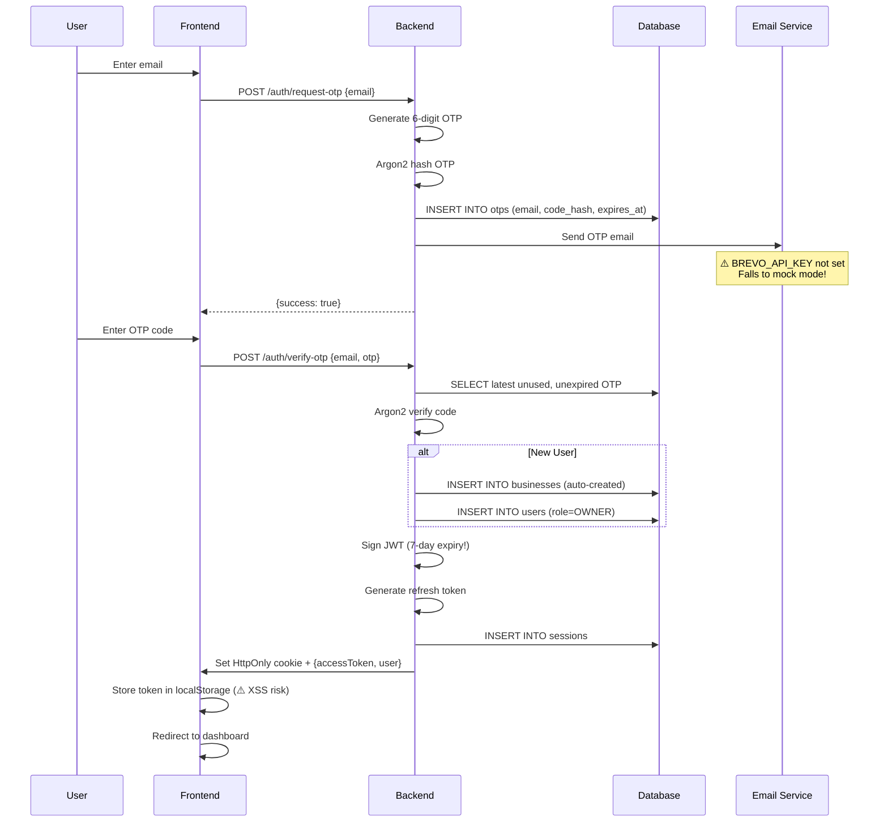
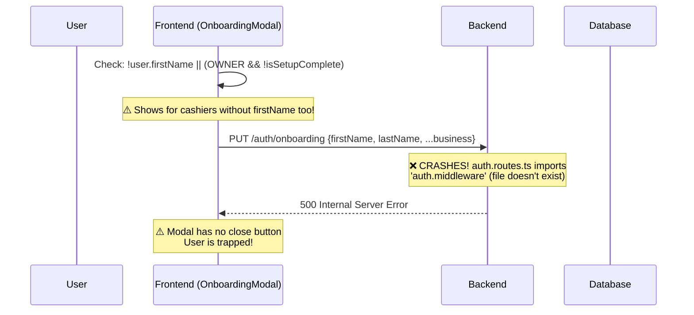
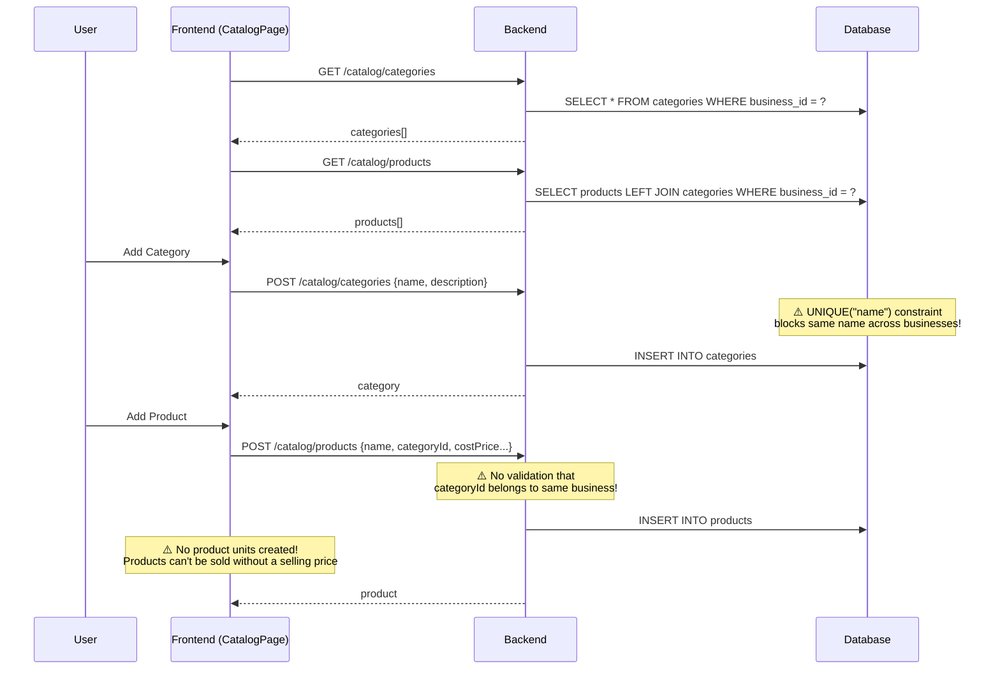
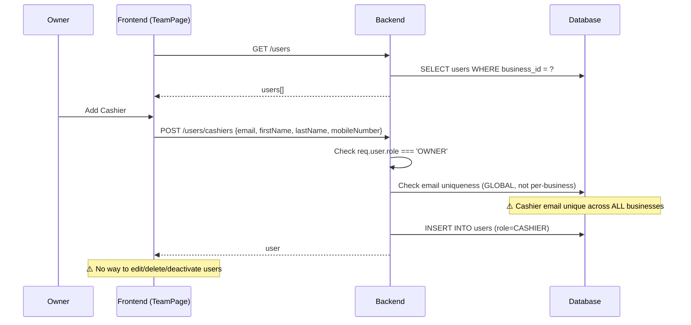
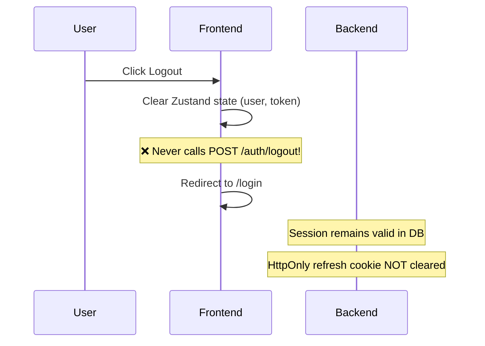

# 🔍 POS Project — Comprehensive Audit Report

> **Scan Date:** June 11, 2026
> **Scope:** Full codebase — Backend, Frontend, Database, Documentation
> **Total Issues Found:** 71 across all layers

---

## Table of Contents

1. [Executive Summary](#1-executive-summary)
2. [Data Flow Analysis](#2-data-flow-analysis)
3. [Critical Bugs (Must Fix Now)](#3-critical-bugs--must-fix-now)
4. [Database Anomalies](#4-database-anomalies)
5. [Backend Issues](#5-backend-issues)
6. [Frontend Issues](#6-frontend-issues)
7. [Documentation & Architecture Drift](#7-documentation--architecture-drift)
8. [Prioritized Action Plan](#8-prioritized-action-plan)

---

## 1. Executive Summary

The POS system is in **early development (~20-25% complete)** with Phases 1-3 partially built and Phases 4-9 not started. The codebase has **critical bugs that would prevent basic operation** — broken imports crash the backend, migrations are out of sync with the schema, and security configurations use insecure defaults.

### Severity Breakdown

| Severity | Count | Description |
|----------|-------|-------------|
| 🔴 **CRITICAL** | 14 | App crashes, security vulnerabilities, data corruption risks |
| 🟠 **HIGH** | 19 | Broken flows, data integrity issues, major functional gaps |
| 🟡 **MEDIUM** | 24 | Missing validations, poor UX, code quality issues |
| 🟢 **LOW** | 14 | Dead code, naming inconsistencies, minor polish |

> [!CAUTION]
> **The application cannot function correctly in its current state.** There are broken imports that crash the server on startup, migrations that don't match the schema, and JWT secrets that fall back to insecure defaults. These must be addressed before any further feature work.

---

## 2. Data Flow Analysis

### 2a. 🔐 Login / Registration Flow (OTP-based)



#### Issues in this flow:

| # | Issue | Severity | Location |
|---|-------|----------|----------|
| 1 | Email service checks `BREVO_API_KEY` but `.env` has `RESEND_API_KEY` — OTPs never sent | 🔴 | [email.service.ts](file:///home/moha/Projects/POS/backend/src/core/services/email.service.ts) |
| 2 | No rate limiting — attacker can flood any email with OTPs | 🟠 | [auth.service.ts](file:///home/moha/Projects/POS/backend/src/modules/auth/auth.service.ts) |
| 3 | Old OTPs not invalidated when new one requested | 🟠 | [auth.service.ts](file:///home/moha/Projects/POS/backend/src/modules/auth/auth.service.ts) |
| 4 | OTP verification is not atomic — race condition allows reuse | 🟠 | [auth.service.ts](file:///home/moha/Projects/POS/backend/src/modules/auth/auth.service.ts) |
| 5 | JWT expires in 7 days (docs say 15 min) | 🔴 | [auth.service.ts](file:///home/moha/Projects/POS/backend/src/modules/auth/auth.service.ts#L109) |
| 6 | JWT_SECRET evaluated before `dotenv.config()` — uses insecure fallback | 🔴 | [auth.ts](file:///home/moha/Projects/POS/backend/src/core/middleware/auth.ts#L4), [auth.service.ts](file:///home/moha/Projects/POS/backend/src/modules/auth/auth.service.ts#L9) |
| 7 | Access token stored in `localStorage` via Zustand persist | 🔴 | [auth.store.ts](file:///home/moha/Projects/POS/frontend/src/features/auth/stores/auth.store.ts#L52-L54) |

---

### 2b. 📋 Onboarding Flow (First-Time Setup)



#### Issues in this flow:

| # | Issue | Severity | Location |
|---|-------|----------|----------|
| 1 | `auth.routes.ts` imports from `auth.middleware` — file doesn't exist (it's `auth.ts`) | 🔴 | [auth.routes.ts:3](file:///home/moha/Projects/POS/backend/src/modules/auth/auth.routes.ts#L3) |
| 2 | Imports `requireAuth` — export is actually `authenticate` | 🔴 | [auth.routes.ts:3](file:///home/moha/Projects/POS/backend/src/modules/auth/auth.routes.ts#L3) |
| 3 | Controller accesses `req.user.sub` — should be `req.user.id` | 🔴 | [auth.controller.ts:73](file:///home/moha/Projects/POS/backend/src/modules/auth/auth.controller.ts#L73) |
| 4 | No role check — any user (including CASHIER) can modify business | 🟠 | [auth.service.ts](file:///home/moha/Projects/POS/backend/src/modules/auth/auth.service.ts#L141-L175) |
| 5 | Not idempotent — can overwrite completed onboarding | 🟡 | [auth.service.ts](file:///home/moha/Projects/POS/backend/src/modules/auth/auth.service.ts#L141-L175) |
| 6 | Cashiers without `firstName` see business onboarding form | 🟠 | [DashboardLayout.tsx:53](file:///home/moha/Projects/POS/frontend/src/components/DashboardLayout.tsx#L53) |
| 7 | Modal has no close/escape — user permanently trapped if API fails | 🟠 | [OnboardingModal.tsx](file:///home/moha/Projects/POS/frontend/src/features/auth/components/OnboardingModal.tsx#L60-L229) |

---

### 2c. 📦 Catalog Management Flow (Categories & Products)



#### Issues in this flow:

| # | Issue | Severity | Location |
|---|-------|----------|----------|
| 1 | `categories` has global `UNIQUE("name")` in migration — blocks same name across businesses | 🟠 | Migration 0002 vs [schema.ts](file:///home/moha/Projects/POS/backend/src/db/schema.ts#L49-L50) |
| 2 | No validation that `categoryId` belongs to caller's `businessId` | 🟠 | [catalog.service.ts:24-33](file:///home/moha/Projects/POS/backend/src/modules/catalog/catalog.service.ts#L24-L33) |
| 3 | No product units created — products have no selling price | 🟠 | Frontend has no product unit UI |
| 4 | No product ownership validation on `createProductUnit` | 🟠 | [catalog.service.ts:72-81](file:///home/moha/Projects/POS/backend/src/modules/catalog/catalog.service.ts#L72-L81) |
| 5 | Missing default-unit mutual exclusion logic | 🟡 | [catalog.service.ts:73](file:///home/moha/Projects/POS/backend/src/modules/catalog/catalog.service.ts#L73) |
| 6 | N+1 style query in `getProductDetails` | 🟡 | [catalog.service.ts:54-68](file:///home/moha/Projects/POS/backend/src/modules/catalog/catalog.service.ts#L54-L68) |
| 7 | No PATCH/DELETE endpoints for categories or products | 🟡 | [catalog.routes.ts](file:///home/moha/Projects/POS/backend/src/modules/catalog/catalog.routes.ts) |
| 8 | No pagination on product/category lists | 🟡 | [catalog.service.ts](file:///home/moha/Projects/POS/backend/src/modules/catalog/catalog.service.ts) |

---

### 2d. 👥 Team Management Flow



#### Issues in this flow:

| # | Issue | Severity | Location |
|---|-------|----------|----------|
| 1 | Email uniqueness check is global — cashier can't exist in multiple businesses | 🟡 | [users.service.ts](file:///home/moha/Projects/POS/backend/src/modules/users/users.service.ts) |
| 2 | No update/delete/deactivate endpoints | 🟡 | [users.routes.ts](file:///home/moha/Projects/POS/backend/src/modules/users/users.routes.ts) |
| 3 | No pagination | 🟡 | [users.service.ts](file:///home/moha/Projects/POS/backend/src/modules/users/users.service.ts#L7-L21) |
| 4 | How does a cashier log in? They can only register via owner; OTP flow creates a new business | 🟠 | [auth.service.ts](file:///home/moha/Projects/POS/backend/src/modules/auth/auth.service.ts) |

---

### 2e. 🔓 Logout Flow



#### Issues:

| # | Issue | Severity |
|---|-------|----------|
| 1 | Frontend never calls `POST /auth/logout` | 🟠 |
| 2 | Backend logout only clears cookie, doesn't revoke DB session | 🟡 |
| 3 | Logout route has no auth middleware — can be called anonymously | 🟡 |

---

## 3. Critical Bugs — Must Fix Now

> [!CAUTION]
> These 14 issues will cause crashes, security breaches, or data corruption.

### 🔴 C-01: Broken Import Crashes Auth Routes

**File:** [auth.routes.ts:3](file:///home/moha/Projects/POS/backend/src/modules/auth/auth.routes.ts#L3)

```diff
- import { requireAuth } from '../../core/middleware/auth.middleware';
+ import { authenticate } from '../../core/middleware/auth';
```

The file `auth.middleware.ts` doesn't exist (it's `auth.ts`), and the export is `authenticate` not `requireAuth`. This crashes ALL auth routes at startup.

---

### 🔴 C-02: Wrong Property Access in Onboarding

**File:** [auth.controller.ts:73](file:///home/moha/Projects/POS/backend/src/modules/auth/auth.controller.ts#L73)

```diff
- const userId = (req as any).user.sub;
+ const userId = req.user!.id;
```

The auth middleware maps JWT `sub` → `req.user.id`, not `req.user.sub`. This makes `userId` always `undefined`.

---

### 🔴 C-03: JWT_SECRET Uses Insecure Fallback

**Files:** [auth.ts:4](file:///home/moha/Projects/POS/backend/src/core/middleware/auth.ts#L4), [auth.service.ts:9](file:///home/moha/Projects/POS/backend/src/modules/auth/auth.service.ts#L9)

```typescript
const JWT_SECRET = process.env.JWT_SECRET || 'fallback_secret';
```

ES module imports are hoisted — these evaluate **before** `dotenv.config()` runs in `index.ts`. Both default to `'fallback_secret'`, making all JWTs trivially forgeable.

**Fix:** Move `dotenv.config()` to the top of the entry file before any imports, or add `dotenv.config()` in each module, or use a config module pattern.

---

### 🔴 C-04: Email Service Checks Wrong Env Var

**File:** [email.service.ts:7](file:///home/moha/Projects/POS/backend/src/core/services/email.service.ts#L7)

The `.env` has `RESEND_API_KEY` but `email.service.ts` checks `BREVO_API_KEY`. Since `BREVO_API_KEY` is never set, OTPs are **never actually sent** — they only print to console.

---

### 🔴 C-05: Migrations Out of Sync with Schema

The schema defines 7 tables with `business_id` columns, but migrations only know about 6 tables. The `businesses` table has **no migration**. Running `drizzle-kit migrate` on a fresh DB creates a schema incompatible with the application code.

**Missing from migrations:**
- Entire `businesses` table
- `users.business_id`, `users.first_name`, `users.last_name`, `users.mobile_number`
- `sessions.business_id`
- `categories.business_id`
- `products.business_id`
- `product_units.business_id`

**Fix:** Run `drizzle-kit generate` to create a migration covering all new columns.

---

### 🔴 C-06: Migration Has Wrong Data Type

**File:** Migration `0000_lean_piledriver.sql`

The `otps.attempts` column was created as `timestamp` instead of `integer`. Fixed in migration 0001, but initial migration is broken.

---

### 🔴 C-07: Zero Database Indexes

No indexes exist on any table. Every query filtering by `business_id`, `email`, `category_id`, `product_id`, or `expires_at` performs **full table scans**.

---

### 🔴 C-08: Zero CHECK Constraints

`products.cost_price` and `product_units.selling_price` have no `>= 0` checks. Negative prices can be inserted.

---

### 🔴 C-09: Hardcoded API Key in Committed File

**File:** [test-resend.js:3](file:///home/moha/Projects/POS/backend/test-resend.js#L3)

```javascript
const resend = new Resend('re_c5aXgo1V_MSSF7ZbpuYvwwsvAtoFabbK4');
```

This API key is in a committed file. Should be rotated immediately.

---

### 🔴 C-10: Access Token in localStorage

**File:** [auth.store.ts:52-54](file:///home/moha/Projects/POS/frontend/src/features/auth/stores/auth.store.ts#L52-L54)

Zustand `persist` stores the access token in `localStorage`, making it vulnerable to XSS attacks. Use `partialize` to exclude it:

```typescript
persist(
  (set, get) => { ... },
  { 
    name: 'pos-auth-storage',
    partialize: (state) => ({ user: state.user, isAuthenticated: state.isAuthenticated })
  }
)
```

---

### 🔴 C-11: JWT Expiry is 7 Days (Should Be 15 Min)

**File:** [auth.service.ts:109](file:///home/moha/Projects/POS/backend/src/modules/auth/auth.service.ts#L109)

```typescript
{ expiresIn: '7d' }  // Should be '15m' per AUTH_DESIGN.md
```

A stolen token grants 7 days of access. This is especially dangerous combined with localStorage storage.

---

### 🔴 C-12: Token Refresh Not Implemented

**File:** [auth.service.ts:177-184](file:///home/moha/Projects/POS/backend/src/modules/auth/auth.service.ts#L177-L184)

`refreshSession()` throws `'Not implemented yet'`. No `/auth/refresh` route exists. Frontend refresh interceptor is commented out. If JWT expiry is reduced to 15 min, users will be logged out every 15 minutes with no way to refresh.

---

### 🔴 C-13: `sameSite: 'strict'` Breaks Cross-Origin Cookies

**File:** [auth.controller.ts:37](file:///home/moha/Projects/POS/backend/src/modules/auth/auth.controller.ts#L37)

The refresh token cookie uses `sameSite: 'strict'` but the app is cross-origin (frontend on Netlify, backend on Railway). The cookie will **never be sent** on cross-origin requests.

**Fix:** Change to `sameSite: 'none'` with `secure: true`.

---

### 🔴 C-14: `setupInterceptors` Race Condition

**File:** [auth.store.ts:29-32](file:///home/moha/Projects/POS/frontend/src/features/auth/stores/auth.store.ts#L29-L32)

`setupInterceptors` is called during store creation. `get()` may not work correctly because the store hasn't fully initialized. If the interceptor fires before hydration, `get().accessToken` returns `null` even with a persisted token.

---

## 4. Database Anomalies

### 4a. Schema vs Migration Mismatches

| Issue | Details | Fix |
|-------|---------|-----|
| `categories` has stale `UNIQUE("name")` | Migration created it, schema removed it. Two businesses can't create "Plumbing" | Generate new migration to drop the constraint |
| `product_units.onDelete` mismatch | Schema says `cascade`, migration says `restrict` | Fix schema to say `restrict` (safer) |
| Missing `UNIQUE(product_id, name)` on `product_units` | Documented but not implemented — allows duplicate unit names | Add composite unique constraint |
| `products.createdBy` missing `onDelete` | Deleting user leaves dangling FK. Should be `SET NULL` | Add `onDelete: 'set null'` |

### 4b. Missing Structural Elements

| Missing Element | Impact |
|----------------|--------|
| **Indexes on `business_id`** (all tables) | Full table scans on every multi-tenant query |
| **Indexes on `email`** (users, otps) | Slow lookups during auth |
| **Indexes on `expires_at`** (otps, sessions) | Slow expiry checks |
| **CHECK constraints** (`cost_price >= 0`, `selling_price >= 0`) | Negative prices allowed |
| **PostgreSQL enums** (`user_role`, etc.) | Using `varchar(50)` — any string accepted for role |

### 4c. `updatedAt` Never Updates

All tables have `updatedAt: timestamp().defaultNow()`, but `defaultNow()` only sets the value on INSERT. No trigger or hook updates it on modifications. Every row's `updatedAt` equals `createdAt`.

**Fix:** Add `.$onUpdateFn(() => new Date())` in Drizzle or create a PostgreSQL trigger.

### 4d. Connection Pool Not Configured

**File:** [db/index.ts:8-10](file:///home/moha/Projects/POS/backend/src/db/index.ts#L8-L10)

No `max`, `idleTimeoutMillis`, or `connectionTimeoutMillis`. Neon has connection limits that could be exceeded.

### 4e. 12 Tables Documented But Not Created

These are expected for future phases but should be tracked:

`suppliers`, `purchases`, `purchase_items`, `customers`, `sales`, `sale_items`, `payments`, `stock_movements`, `refunds`, `refund_items`, `damaged_goods`, `audit_logs`

---

## 5. Backend Issues

### 🟠 High Priority

| # | Issue | Location | Fix |
|---|-------|----------|-----|
| B-01 | No OTP rate limiting | [auth.service.ts](file:///home/moha/Projects/POS/backend/src/modules/auth/auth.service.ts#L12-L31) | Add express-rate-limit on `/auth/request-otp` |
| B-02 | Old OTPs not invalidated on new request | [auth.service.ts](file:///home/moha/Projects/POS/backend/src/modules/auth/auth.service.ts#L12-L31) | Mark all unused OTPs as `used` before creating new one |
| B-03 | OTP verification race condition | [auth.service.ts](file:///home/moha/Projects/POS/backend/src/modules/auth/auth.service.ts#L33-L67) | Use a transaction with `FOR UPDATE` lock |
| B-04 | Logout doesn't revoke DB session | [auth.controller.ts:59-67](file:///home/moha/Projects/POS/backend/src/modules/auth/auth.controller.ts#L59-L67) | Update session `revoked = true` |
| B-05 | No OWNER role check on onboarding | [auth.service.ts:141-175](file:///home/moha/Projects/POS/backend/src/modules/auth/auth.service.ts#L141-L175) | Add role guard |
| B-06 | No cross-tenant category validation on product create | [catalog.service.ts:24-33](file:///home/moha/Projects/POS/backend/src/modules/catalog/catalog.service.ts#L24-L33) | Verify `categoryId` belongs to `businessId` |
| B-07 | No product ownership validation on unit create | [catalog.service.ts:72-81](file:///home/moha/Projects/POS/backend/src/modules/catalog/catalog.service.ts#L72-L81) | Verify `productId` belongs to `businessId` |
| B-08 | Cashier login flow undefined | [auth.service.ts](file:///home/moha/Projects/POS/backend/src/modules/auth/auth.service.ts) | OTP verify auto-creates business — cashiers need different path |

### 🟡 Medium Priority

| # | Issue | Location | Fix |
|---|-------|----------|-----|
| B-09 | All errors return 400/VALIDATION_ERROR | [auth.controller.ts:16-24](file:///home/moha/Projects/POS/backend/src/modules/auth/auth.controller.ts#L16-L24) | Differentiate error types (400 vs 500) |
| B-10 | Inconsistent error response format | Auth vs Users controllers | Create standard `AppError` class |
| B-11 | No global error handler | [index.ts](file:///home/moha/Projects/POS/backend/src/index.ts) | Add Express error middleware |
| B-12 | No security headers (Helmet) | [index.ts](file:///home/moha/Projects/POS/backend/src/index.ts) | Add `helmet()` middleware |
| B-13 | No mobile number format validation | [auth.schema.ts:15](file:///home/moha/Projects/POS/backend/src/modules/auth/auth.schema.ts#L15) | Add regex pattern |
| B-14 | No pagination on any list endpoint | All services | Add `limit`/`offset` parameters |
| B-15 | Onboarding not idempotent | [auth.service.ts:141](file:///home/moha/Projects/POS/backend/src/modules/auth/auth.service.ts#L141) | Check `isSetupComplete` first |
| B-16 | OTP records never cleaned up | [auth.service.ts](file:///home/moha/Projects/POS/backend/src/modules/auth/auth.service.ts) | Add cron job or cleanup on request |
| B-17 | `console.log` in production code | Multiple files | Replace with Pino logger |
| B-18 | Magic numbers throughout | [auth.service.ts](file:///home/moha/Projects/POS/backend/src/modules/auth/auth.service.ts) | Extract to `constants.ts` |

### 🟢 Low Priority

| # | Issue | Location |
|---|-------|----------|
| B-19 | Dead code: `test-resend.js`, `RESEND_API_KEY` | Root files |
| B-20 | `drop.js` has no env safeguard | [drop.js](file:///home/moha/Projects/POS/backend/drop.js) |
| B-21 | Refresh/access tokens have same 7d expiry | [auth.service.ts](file:///home/moha/Projects/POS/backend/src/modules/auth/auth.service.ts) |
| B-22 | No CSRF protection | Backend-wide |
| B-23 | `unique()` on `refreshTokenHash` unnecessary | [schema.ts](file:///home/moha/Projects/POS/backend/src/db/schema.ts) |

---

## 6. Frontend Issues

### 🟠 High Priority

| # | Issue | Location | Fix |
|---|-------|----------|-----|
| F-01 | Frontend logout never calls `POST /auth/logout` | [auth.store.ts:45-49](file:///home/moha/Projects/POS/frontend/src/features/auth/stores/auth.store.ts#L45-L49) | Add API call before clearing state |
| F-02 | `VerifyOtpResponse` type missing fields | [auth.api.ts:9-20](file:///home/moha/Projects/POS/frontend/src/features/auth/api/auth.api.ts#L9-L20) | Add `firstName`, `lastName`, `isSetupComplete`, etc. |
| F-03 | No selling price / product units in frontend | No file | Build product unit creation into AddProductModal |
| F-04 | 5 nav links point to non-existent routes | [DashboardLayout.tsx:23-29](file:///home/moha/Projects/POS/frontend/src/components/DashboardLayout.tsx#L23-L29) | Add placeholder pages or disable links |
| F-05 | No 404 catch-all route | [App.tsx](file:///home/moha/Projects/POS/frontend/src/App.tsx#L14-L34) | Add `<Route path="*" element={<NotFound />} />` |
| F-06 | OnboardingModal traps cashiers | [DashboardLayout.tsx:53](file:///home/moha/Projects/POS/frontend/src/components/DashboardLayout.tsx#L53) | Split logic for OWNER vs CASHIER |
| F-07 | OnboardingModal has no close button | [OnboardingModal.tsx](file:///home/moha/Projects/POS/frontend/src/features/auth/components/OnboardingModal.tsx) | Add escape/close for error recovery |
| F-08 | No error states on data queries | [ProductList.tsx](file:///home/moha/Projects/POS/frontend/src/features/catalog/components/ProductList.tsx), [TeamList.tsx](file:///home/moha/Projects/POS/frontend/src/features/team/components/TeamList.tsx) | Handle `isError` from useQuery |

### 🟡 Medium Priority

| # | Issue | Location |
|---|-------|----------|
| F-09 | `any` type used in 6+ error handlers | All modal/form components |
| F-10 | `App.css` is unused Vite boilerplate (185 lines) | [App.css](file:///home/moha/Projects/POS/frontend/src/App.css) |
| F-11 | Category name truncation hardcoded to 8 chars | [ProductList.tsx:247](file:///home/moha/Projects/POS/frontend/src/features/catalog/components/ProductList.tsx#L247) |
| F-12 | `costPrice` typed as `string` in frontend, `number` in backend | [catalog.api.ts:16-18](file:///home/moha/Projects/POS/frontend/src/features/catalog/api/catalog.api.ts#L16-L18) |
| F-13 | Notification badge always visible | [DashboardLayout.tsx:137](file:///home/moha/Projects/POS/frontend/src/components/DashboardLayout.tsx#L137) |
| F-14 | Settings button does nothing | [DashboardLayout.tsx:107-109](file:///home/moha/Projects/POS/frontend/src/components/DashboardLayout.tsx#L107-L109) |
| F-15 | Edit/More buttons on products do nothing | [ProductList.tsx:260-265](file:///home/moha/Projects/POS/frontend/src/features/catalog/components/ProductList.tsx#L260-L265) |
| F-16 | `index.html` title is "frontend" | [index.html:7](file:///home/moha/Projects/POS/frontend/index.html#L7) |
| F-17 | No mobile number format validation on forms | OnboardingModal, AddUserModal |
| F-18 | OTP input doesn't auto-focus | [LoginForm.tsx:99-109](file:///home/moha/Projects/POS/frontend/src/features/auth/components/LoginForm.tsx#L99-L109) |

### 🟢 Low Priority

| # | Issue | Location |
|---|-------|----------|
| F-19 | No keyboard accessibility on modals (Escape, focus trap) | All modals |
| F-20 | Missing `aria-label` on icon-only buttons | Throughout |
| F-21 | CustomDropdown has no keyboard navigation | [ProductList.tsx:11-93](file:///home/moha/Projects/POS/frontend/src/features/catalog/components/ProductList.tsx#L11-L93) |
| F-22 | Date formatting runs on every render | [DashboardLayout.tsx:35-39](file:///home/moha/Projects/POS/frontend/src/components/DashboardLayout.tsx#L35-L39) |
| F-23 | Unnecessary `import React` in React 19 | All components |
| F-24 | Modals in DOM when closed (opacity-0) — hooks run unnecessarily | AddCategoryModal, AddProductModal |

---

## 7. Documentation & Architecture Drift

> [!IMPORTANT]
> The codebase has made a **major undocumented architectural decision**: multi-tenancy via a `businesses` table. This is not reflected in any documentation and fundamentally changes the security model, data isolation, and every future feature.

### 7a. Key Docs-vs-Code Divergences

| Area | Documentation Says | Code Does |
|------|-------------------|-----------|
| **Architecture** | Single-tenant, single-business | Multi-tenant with `businesses` table |
| **API versioning** | `/api/v1/...` | No versioning — `/auth/...`, `/catalog/...` |
| **Layering** | Controller → Service → Repository | No repository layer |
| **Email provider** | Resend | Brevo (Sendinblue) |
| **Frontend hosting** | Vercel | Netlify (has `netlify.toml`) |
| **JWT expiry** | 15 minutes | 7 days |
| **User roles** | Only OWNER mentioned | OWNER + CASHIER implemented |
| **Validation files** | `*.validation.ts` | `*.schema.ts` |
| **API query files** | `*.queries.ts` | `*.api.ts` |
| **Error handling** | `AppError` class | Raw `Error()` objects |
| **Logging** | Pino | `console.log` |
| **Env validation** | Zod schema at startup | Raw `process.env` with fallbacks |

### 7b. Roadmap Progress

| Phase | Status | Completion |
|-------|--------|------------|
| Phase 1 — Foundation | ⚠️ Partial | ~50% |
| Phase 2 — Authentication | ⚠️ Partial | ~60% |
| Phase 3 — Product Catalog | ⚠️ Partial | ~40% |
| Phase 4 — Inventory & Purchasing | ❌ Not Started | 0% |
| Phase 5 — Sales & POS | ❌ Not Started | 0% |
| Phase 6 — M-Pesa Integration | ❌ Not Started | 0% |
| Phase 7 — Refunds & Credit | ❌ Not Started | 0% |
| Phase 8 — Reporting | ❌ Not Started | 0% |
| Phase 9 — Data Import & Polish | ❌ Not Started | 0% |

**Overall: ~20-25% of planned features implemented**

### 7c. New Open Questions

1. Was multi-tenancy an intentional decision? It affects every future module.
2. Why was the email provider changed from Resend to Brevo? Docs need updating.
3. Why was frontend deployment target changed from Vercel to Netlify?
4. Why is JWT expiry 7 days instead of the documented 15 minutes?
5. How should cashiers log in? The OTP flow auto-creates a new business.

---

## 8. Prioritized Action Plan

### 🚨 Phase 0: Emergency Fixes (Do These First)

These bugs prevent the app from functioning at all:

| Priority | Task | Effort |
|----------|------|--------|
| P0-1 | Fix `auth.routes.ts` broken import (`auth.middleware` → `auth`, `requireAuth` → `authenticate`) | 5 min |
| P0-2 | Fix `auth.controller.ts` onboarding (`req.user.sub` → `req.user.id`) | 5 min |
| P0-3 | Fix dotenv loading order — move `dotenv.config()` before imports, or use a config module | 15 min |
| P0-4 | Fix email service env var (`BREVO_API_KEY` alignment with `.env`) | 5 min |
| P0-5 | Generate missing database migration (`drizzle-kit generate`) | 10 min |
| P0-6 | Rotate the hardcoded Resend API key and delete `test-resend.js` | 10 min |

### 🔒 Phase 1: Security Hardening

| Priority | Task | Effort |
|----------|------|--------|
| P1-1 | Reduce JWT expiry to 15 minutes | 5 min |
| P1-2 | Implement `POST /auth/refresh` endpoint and frontend interceptor | 2 hours |
| P1-3 | Exclude `accessToken` from Zustand persist (use `partialize`) | 15 min |
| P1-4 | Fix `sameSite: 'none'` with `secure: true` for cross-origin cookies | 5 min |
| P1-5 | Add `express-rate-limit` on OTP request endpoint | 30 min |
| P1-6 | Add `helmet` middleware for security headers | 10 min |
| P1-7 | Invalidate old OTPs when new one is requested | 15 min |
| P1-8 | Make OTP verification atomic (transaction + FOR UPDATE) | 30 min |
| P1-9 | Add env validation with Zod at startup (remove fallback secrets) | 30 min |

### 🗄️ Phase 2: Database Stabilization

| Priority | Task | Effort |
|----------|------|--------|
| P2-1 | Add indexes on all `business_id` columns | 20 min |
| P2-2 | Add indexes on `email`, `expires_at`, `category_id`, `product_id` | 20 min |
| P2-3 | Fix `categories` UNIQUE constraint (drop global, add per-business) | 15 min |
| P2-4 | Fix `product_units.onDelete` to match intended behavior (RESTRICT) | 10 min |
| P2-5 | Add `UNIQUE(product_id, name)` on `product_units` | 10 min |
| P2-6 | Add CHECK constraints on price columns | 10 min |
| P2-7 | Fix `updatedAt` — add trigger or Drizzle hook | 20 min |
| P2-8 | Configure connection pool limits | 10 min |

### 🔧 Phase 3: Backend Quality

| Priority | Task | Effort |
|----------|------|--------|
| P3-1 | Create `AppError` class and global error handler | 1 hour |
| P3-2 | Add role guard middleware (`authorize(roles)`) | 30 min |
| P3-3 | Add cross-tenant validation on catalog operations | 30 min |
| P3-4 | Implement logout session revocation | 30 min |
| P3-5 | Add pagination to all list endpoints | 1 hour |
| P3-6 | Add mobile number format validation | 15 min |
| P3-7 | Define cashier login flow (find existing user by email) | 1 hour |
| P3-8 | Standardize error response format across all controllers | 30 min |

### 🖥️ Phase 4: Frontend Quality

| Priority | Task | Effort |
|----------|------|--------|
| P4-1 | Fix logout to call `POST /auth/logout` | 15 min |
| P4-2 | Update `VerifyOtpResponse` type with all fields | 15 min |
| P4-3 | Fix onboarding modal: add close button, split OWNER/CASHIER logic | 30 min |
| P4-4 | Add error states to all query-based components | 30 min |
| P4-5 | Add 404 catch-all route | 15 min |
| P4-6 | Disable or add placeholder pages for unimplemented nav items | 30 min |
| P4-7 | Build product unit creation into product workflow | 2 hours |
| P4-8 | Replace all `any` types with proper types | 1 hour |
| P4-9 | Delete unused `App.css` | 5 min |
| P4-10 | Fix `index.html` title | 5 min |

### 📝 Phase 5: Documentation Update

| Priority | Task | Effort |
|----------|------|--------|
| P5-1 | Document multi-tenancy architecture decision | 30 min |
| P5-2 | Update AUTH_DESIGN.md with actual JWT/refresh flow | 20 min |
| P5-3 | Update DEPLOYMENT.md (Brevo, Netlify, Railway) | 20 min |
| P5-4 | Update DATABASE_SCHEMA.md with `businesses` table | 20 min |
| P5-5 | Document CASHIER role and team management | 20 min |
| P5-6 | Update FOLDER_STRUCTURE.md to match reality | 20 min |

---

> [!TIP]
> **Recommended approach:** Tackle Phase 0 immediately (< 1 hour), then Phase 1 security fixes (half day), then Phase 2 database fixes (half day). This stabilizes the foundation before building more features.
